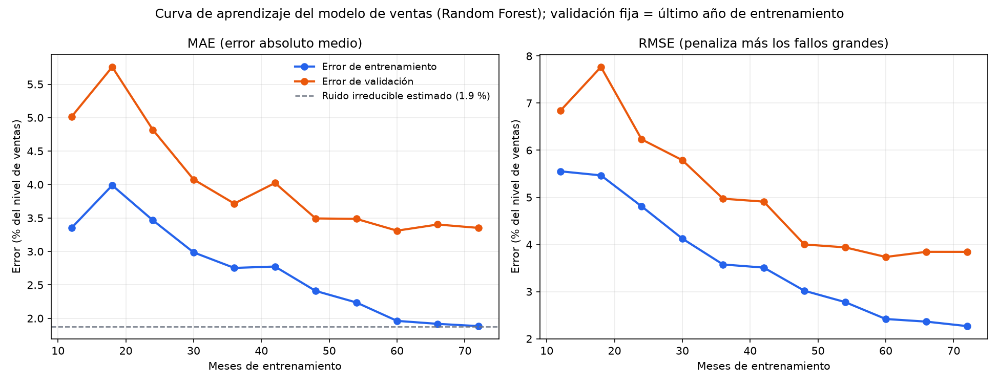

# Evaluación técnica del modelo de ventas de Brasaland

Modelo evaluado: **Random Forest** (el elegido en el PR anterior, sin cambios), que predice `revenue_usd` de la fila
`consolidated` de `data/raw/brasaland_sales.csv`. Esta evaluación responde las tres preguntas del ticket del tech lead.

## Resumen

| Pregunta | Respuesta |
| --- | --- |
| ¿Underfitting, overfitting o bien ajustado? | **Bien ajustado**, con una brecha de generalización moderada (1,5 puntos). No es un sobreajuste corregible: regularizar más lo empeora. |
| ¿Qué tan estable es si cambia la porción de datos de entrenamiento? | **Estable desde los 48 meses** (error de validación 3,3-3,5 %). Con 24-36 meses de entrenamiento es inestable (4,7-5,8 %). Validación cruzada: MAE 4,12 ± 1,11 %. |
| ¿Acción correctiva? | **No regularizar ni complicar el modelo.** El error que sobra sobre el ruido es un sesgo cíclico del crecimiento anual. Aprobar el paso a staging con la salida expresada como rango y vigilar el sesgo (sección 6). |

Todas las cifras salen de `data/eval/evaluation_metrics.json`; se regeneran con
`uv run python scripts/evaluate_sales_model.py`.

## 1. Alcance y método

- **Solo se usan los 96 meses de entrenamiento** (2016-01 → 2023-12). Los 2 años de prueba no intervienen.
- **Validación cruzada temporal:** `TimeSeriesSplit(n_splits=5, test_size=12)` sobre las 84 filas útiles. Cada fold
  valida un año completo y el entrenamiento crece siempre desde el primer mes (24, 36, 48, 60 y 72 meses). Los años de
  validación son 2019, 2020, 2021, 2022 y 2023.
- **Ningún fold mezcla ni baraja datos.** La función `verify_folds` se ejecuta en cada evaluación y lanza un error si los
  índices no son consecutivos, si el entrenamiento no es anterior a la validación o si dos validaciones se solapan.
  El test `tests/pipelines/test_cv_chronology.py` lo comprueba, y se verificó que detecta fugas inyectadas a propósito.
- **Sin fuga en las features de lag y rolling.** Cada feature de un mes usa solo meses anteriores, y las features de
  cada fold se construyen con la serie recortada al final de su ventana de validación: los meses posteriores ni
  existen para ese fold. Un test cambia todo lo posterior a cada fold y comprueba que las features no se alteran.
- **El escalador se ajusta solo con el entrenamiento de cada fold** (va dentro del `Pipeline`).
- **Errores "un mes por delante"** tanto en entrenamiento como en validación, para que sean comparables entre sí.
  Además se reporta el error recursivo de 12 meses de cada fold (sección 2).
- **Unidades:** USD, y también "% del nivel de ventas" (error dividido por la media de los 12 meses previos). El
  porcentaje permite comparar años distintos: los recientes venden más y el error en dólares crece solo por eso.

## 2. Resultados de la validación cruzada

| Fold | Entrena (meses) | Valida | MAE entren. | MAE valid. | RMSE valid. | Sesgo valid.* |
| --- | --- | --- | --- | --- | --- | --- |
| 1 | 24 | 2019 | 3,47 % ($18.486) | 4,69 % ($26.725) | 5,64 % ($32.206) | −1,56 % |
| 2 | 36 | 2020 | 2,75 % ($15.037) | 5,81 % ($34.878) | 7,74 % ($46.593) | +1,63 % |
| 3 | 48 | 2021 | 2,41 % ($13.532) | 3,24 % ($20.474) | 3,81 % ($24.136) | −0,16 % |
| 4 | 60 | 2022 | 1,96 % ($11.266) | 3,52 % ($23.263) | 3,94 % ($25.995) | +1,95 % |
| 5 | 72 | 2023 | 1,88 % ($11.087) | 3,35 % ($23.154) | 3,84 % ($26.415) | −1,91 % |

\* Sesgo > 0: el modelo sobreestima ese año; < 0: lo subestima.

**Media ± desviación estándar entre los 5 folds** (desviación muestral, ddof = 1):

| | MAE | RMSE |
| --- | --- | --- |
| **Entrenamiento** | $13.882 ± 3.054 (2,49 ± 0,65 %) | $17.988 ± 5.057 (3,22 ± 1,03 %) |
| **Validación** | $25.699 ± 5.590 (4,12 ± 1,11 %) | $31.069 ± 9.189 (4,99 ± 1,71 %) |

- Error recursivo de 12 meses en validación (el modelo pronostica el año sin ver ninguno de sus meses): MAPE
  4,15 ± 1,02 %.
- La desviación entre folds está dominada por los dos primeros (2019 y 2020), que tienen solo 24 y 36 meses de
  entrenamiento. En los folds 3-5 el MAE de validación es 3,24 %, 3,52 % y 3,35 %, con desviación de 0,14 puntos.

## 3. Qué métrica refleja mejor el costo del negocio: RMSE (con MAE de apoyo)

Qué dice el briefing de Brasaland:

- **Felipe (Operaciones)** anticipa compras de insumos según la tendencia esperada y **Lucía (Procurement)** anticipa
  el precio de la carne según el volumen proyectado. Un fallo grande de volumen desajusta una compra entera.
- **Mariana (CEO)** necesita identificar con antelación los meses de bajo desempeño: le importan más los fallos
  grandes que los pequeños.
- El KPI de error que el briefing pide reportar es el **MSE**, que penaliza igual que el RMSE los errores grandes
  (el RMSE es su raíz y viene en dólares).

Por eso la métrica principal es el **RMSE**. El **MAE** se reporta como apoyo porque es el error típico y se explica
solo ("nos equivocamos de media $25.699, un 4,1 %"). Que el RMSE sea mayor que el MAE (4,99 % frente a 4,12 %) indica que
hay meses con fallos mayores que el típico; en el fold 2 la diferencia es la más marcada (RMSE 7,74 % frente a MAE 5,81 %).

**Limitación del briefing:** no dice si sobreestimar o subestimar cuesta más, y aquí no se inventan cifras de coste.
Lo que sí se puede decir con los datos: el sesgo medio es prácticamente cero (−0,01 ± 1,77 %), pero cambia de signo de
un año a otro (sección 6), de modo que el modelo no tiende a un solo lado. Si Operaciones cuantifica el coste de
sobrecomprar frente al de quedarse sin insumos, habría que ponderar la métrica en esa dirección.

## 4. Curva de aprendizaje



La validación es fija (el último año de entrenamiento, 12 filas) y el entrenamiento son las primeras *n* filas, siempre
anteriores a ella; así la única diferencia entre puntos es el tamaño. Se grafica en % del nivel de ventas.

| Meses de entrenamiento | 12 | 24 | 36 | 48 | 60 | 72 |
| --- | --- | --- | --- | --- | --- | --- |
| MAE entrenamiento | 3,35 % | 3,47 % | 2,75 % | 2,41 % | 1,96 % | 1,88 % |
| MAE validación | 5,01 % | 4,82 % | 3,72 % | 3,49 % | 3,31 % | 3,35 % |

Lectura:

- El error de **entrenamiento** baja con los datos hasta **1,88 %**, que coincide con el ruido irreducible estimado
  (1,88 %, el residuo de la descomposición de la serie; ver el README del modelo). Un modelo no puede honestamente
  bajar de ahí: el modelo ajusta los datos que ve, pero no más allá del ruido.
- El error de **validación** baja de 5,0 % a 3,5 % hasta los 48 meses y **se aplana** en 3,3-3,5 % de ahí en adelante.
- La **brecha** (validación − entrenamiento) es de 1,47 puntos al final y 1,25 a mitad de la curva: no se cierra con
  más datos.

## 5. Diagnóstico: bien ajustado

**Regla fijada antes de calcular nada**, comparando con el ruido irreducible (1,88 %). El README del ticket dice que no
existe una curva "correcta" universal, así que la regla es una convención explícita:

| Diagnóstico | Condición |
| --- | --- |
| Overfitting | MAE de entrenamiento < 0,75 × ruido, brecha > 0,5 × ruido y brecha que no se cierra (≥ 0,8 × la de mitad de curva) |
| Underfitting | MAE de entrenamiento > 1,5 × ruido y validación / entrenamiento < 1,3 |
| Bien ajustado | Ninguna de las dos anteriores |

Resultado con el entrenamiento completo: MAE de entrenamiento 1,88 % (no baja de 0,75 × 1,88 = 1,41 %, así que no hay
memorización de ruido) y de validación 3,35 %. No es underfitting: el entrenamiento está en el ruido, no por encima.
**Clasificación: bien ajustado.**

**Matiz honesto.** La brecha de 1,5 puntos no es nula y no se estrecha, y un lector más estricto podría llamarla
"overfitting moderado". Lo que impide tratarla como overfitting a corregir es la prueba de la sección 6: reducir la
brecha con más regularización **empeora** el error de validación (de 4,12 % a 5,14-5,58 %). Es la brecha normal de un
modelo de árboles con solo 84 filas útiles, no un defecto que se arregle ajustando la complejidad.

## 6. Acción correctiva

**Causa raíz del error que sobra sobre el ruido: un sesgo cíclico ligado al crecimiento anual, no un problema de ajuste.**
El crecimiento anual de la media alterna cada año (6,9 → 2,6 → 7,5 → 3,2 → 6,1 → 3,0 → 9,0 %), como describe el briefing, y el
sesgo del modelo alterna con él: subestima los años de crecimiento alto y sobreestima los de crecimiento bajo.

| Año de validación | Crecimiento anual | Sesgo | MAE |
| --- | --- | --- | --- |
| 2019 | 7,5 % | −1,56 % | 4,69 % |
| 2020 | 3,2 % | +1,63 % | 5,81 % |
| 2021 | 6,1 % | −0,16 % | 3,24 % |
| 2022 | 2,9 % | +1,95 % | 3,52 % |
| 2023 | 9,0 % | −1,91 % | 3,35 % |

La correlación entre crecimiento y sesgo es −0,99 (solo 5 puntos: es orientativa, pero la dirección es nítida). El modelo
extrapola el ritmo del año anterior a partir de lags ruidosos y, con 8 años, solo ha visto 3-4 ciclos de esa alternancia.

**Lo que NO se debe hacer, con la evidencia:**

1. **No regularizar más.** Misma validación cruzada con Random Forest más regularizado:

   | Variante | MAE entrenamiento | MAE validación ± std | Brecha |
   | --- | --- | --- | --- |
   | Actual (hoja mín. 3, 70 % de variables) | 2,49 % | **4,12 ± 1,11 %** | 1,63 |
   | Hoja mín. 6, 70 % | 4,21 % | 5,14 ± 1,09 % | 0,93 |
   | Hoja mín. 10, 70 % | 5,06 % | 5,56 ± 0,61 % | 0,50 |
   | Hoja mín. 6, 40 % | 4,49 % | 5,32 ± 0,78 % | 0,83 |
   | Hoja mín. 10, 40 % | 5,16 % | 5,58 ± 0,44 % | 0,42 |

   Cada paso reduce la brecha pero sube el error de validación: se pasa de un ajuste adecuado a underfitting.
2. **No aumentar la complejidad.** El error de entrenamiento ya está en el ruido; más capacidad solo memorizaría ruido.
3. **No esperar que "más datos" lo arregle a corto plazo.** La validación se aplana desde los 48 meses (3,49 → 3,31 → 3,35 %).
   Los datos nuevos del mismo tipo no cambian el patrón.
4. **No añadir una feature de crecimiento interanual.** Se probó (media de los 12 meses previos / media de los 12 anteriores − 1):
   el MAE de validación sube de 4,12 % a 4,64 % (de 3,98 % a 4,23 % en los folds 2-5, donde pesa menos perder 12 filas de entrenamiento).
   Con solo 3-4 ciclos el modelo no aprende la alternancia.

**Acción concreta recomendada:**

1. **Aprobar el paso a staging con el modelo sin cambios**, sin tocar hiperparámetros.
2. **Entregar la previsión como rango, no como punto, y usar el error de validación cruzada como margen de planificación:**
   MAE 4,1 ± 1,1 % (3,2-3,5 % en los años con 48 o más meses de entrenamiento). Es más exigente que el error de un solo
   periodo de prueba y refleja el sesgo cíclico.
3. **Vigilar el sesgo en staging.** Calcular cada mes el sesgo de los últimos 12 meses y abrir una revisión si supera
   el 2 % en valor absoluto (el mayor observado en validación fue 1,95 %). Un sesgo mayor indicaría un cambio de comportamiento,
   no el ciclo conocido.
4. **Reentrenar cada año al cerrar diciembre** con el nuevo ciclo incluido, y repetir esta evaluación. Atacar de fondo
   el ciclo de crecimiento (una feature o un modelo que lo represente) queda como hipótesis para cuando haya más ciclos
   observados: hoy la prueba de la feature interanual no la respalda.

## 7. Limitaciones

- Solo 84 filas útiles y 5 folds: las desviaciones estándar y la correlación con el crecimiento son orientativas.
- El ruido irreducible (1,88 %) se estima con el residuo de la descomposición, que se mide dentro de la muestra; es una
  referencia, no un límite exacto.
- Los umbrales del diagnóstico son una convención del autor, declarada antes de ver los números; con otros umbrales
  razonables la conclusión se mantiene salvo por el matiz de la sección 5.
- La validación cruzada de este reporte no usa el conjunto de prueba (2024-2025), que seguirá reservado para la
  evaluación final del modelo.

## Cómo reproducirlo

```bash
uv sync
uv run python scripts/evaluate_sales_model.py   # regenera evaluation_metrics.json y learning_curve.png
uv run pytest tests/pipelines -v                # incluye test_cv_chronology.py
```
