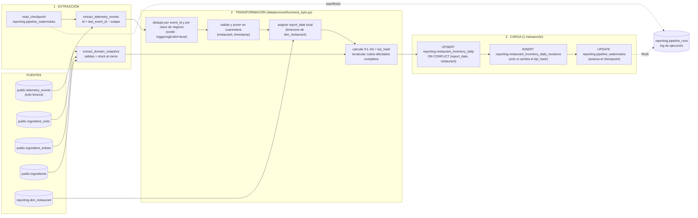

# Pipeline de Desempeño de Negocio — Documento de diseño

**Compañía:** Brasaland (14 restaurantes en Colombia y Florida) · **Fase:** diseño aprobado + implementación (Parte 2) · **Orquestador:** Prefect 3 · **Estado:** v1 implementada; ver «Cambios respecto a la versión aprobada» al final

---

## 0. Resumen y alcance

Este documento diseña un pipeline de datos **nuevo** cuyo único trabajo es convertir la telemetría que ya capturamos en números que un gerente de Operaciones o la CEO puedan leer sin saber qué es un evento: *cuántas salidas de insumos hubo por restaurante, cuánto se pierde por merma, qué restaurantes se acercan a quedarse sin producto*.

**Reglas del encargo que este diseño respeta (y que se verifican en la §11):**

| Regla | Cómo se cumple |
|---|---|
| El reporte técnico de telemetría se queda como está | No se modifica el módulo de análisis (en este repo es `services/api/app/telemetry/analysis.py`) ni `GET /telemetry/report`; este pipeline no los importa ni los llama (ver §1.3). |
| `telemetry_events` es la **fuente**, nunca el destino | El pipeline solo hace `SELECT` sobre `telemetry_events`. Todo lo que escribe vive en el esquema nuevo `reporting`. |
| Resultado en tablas nuevas bajo el esquema `reporting` | §6: `reporting.restaurant_inventory_daily` + 4 tablas de apoyo. |
| Expuesto por un módulo nuevo `services/reporting/` | §9: tres endpoints, separados de `services/telemetry/` y de `GET /telemetry/report`. |
| Orquestación en `data/pipelines/`; transformaciones reutilizables en `data/process/`; los servicios importan de `data/pipelines/` y no al revés | §9.3. |
| Solo se permiten campos aditivos de payload exigidos por el CONTEXT en eventos obligatorios ya existentes | **v1 no necesita ninguno** (§2.4): todos los KPIs salen de campos que los eventos ya emiten más las tablas de dominio. |

### 0.1 De dónde sale el contexto de negocio (y qué está pendiente de validar)

El ticket habla de un `CONTEXT-company.md` de *data pipelines* con las secciones «KPIs a medir», «Destination table», audiencia y frecuencia. **Ese archivo no existe en este monorepo**: el repositorio solo tiene `CONTEXT.md` / `CONTEXT.es.md` (Hitos 1, 5 y 6) y no hay ninguna sección de KPIs ni de tabla destino (el mismo hallazgo que ya se documentó en `docs/telemetry/telemetry-plan.md` §1.1).

Para no inventar un KPI genérico, este diseño **deriva** el contexto de fuentes reales del repo:

| Fuente | Qué aporta |
|---|---|
| `CONTEXT.es.md` · Hito 6 | Entidades `Ingredient`, `IngredientEntry`, `IngredientExit`; `restaurant` como clave de partición; `current_stock = Σ entradas − Σ salidas`; los 14 restaurantes y sus ciudades (Hito 1). |
| `company-choice.md` | El dolor de negocio elegido: *menos roturas de stock, pedidos de ingredientes por local, decisiones de Operaciones*; stakeholder de operaciones (Felipe). |
| `docs/telemetry/telemetry-plan.md` y `event-schemas.json` | Las 7 métricas obligatorias, el envelope y las propiedades exactas de cada evento. |
| Código real (`services/api`, `uis/backoffice`) | Qué se emite hoy, desde dónde y con qué campos (§1.1). |

> ⚑ **Marca de validación.** Todo nombre o cifra que en un CONTEXT oficial vendría dado (el nombre de la *Destination table*, la lista de KPIs, la frecuencia) aparece aquí con ⚑ y es una **propuesta**. Si el `CONTEXT-company.md` oficial llega con otros nombres, se sustituyen en los puntos marcados sin cambiar la arquitectura.

---

## 1. Estado actual (Fase 1)

### 1.1 Qué eventos de telemetría capturamos hoy

- **Catálogo:** 31 eventos diseñados (7 obligatorios + 24 oportunidades), contrato en `docs/telemetry/event-schemas.json` (schema `1.1.0`), con el *Event Envelope* `eventId · timestamp · sessionId · userId · event_type · schemaVersion · requestId · source · properties`.
- **Quién los emite hoy:** **solo el frontend** (`uis/backoffice`, vía `track(...)`). El backend **todavía no emite** ningún evento (los puntos de emisión de `services/api` están definidos en el plan pero no implementados). Consecuencia de diseño: hoy un mismo hecho de negocio llega **como mucho una vez** y solo si el operador usó la interfaz; una llamada directa a la API no deja evento.
- **Los tres eventos obligatorios que alimentan este pipeline** y lo que llevan (`properties` ya filtradas por la allowlist al guardarse):

| Evento | Se emite en | Campos de negocio |
|---|---|---|
| `outbound_order_created` | `inventory-outbound-form.tsx` tras crear la orden | `exitId`, `ingredientId`, `restaurant`, `quantity`, `stockBefore`, `stockAfter`, `reasonProvided` |
| `stock_threshold_triggered` | mismo formulario, cuando la salida **cruza** un umbral hacia abajo | `ingredientId`, `restaurant`, `level` (`low`=30, `critical`=10), `thresholdValue`, `stockBefore`, `stockAfter`, `triggeringExitId` |
| `inventory_validation_failed` | mismo formulario, cuando el servidor rechaza (400/404) | `operation`, `errorCode`, `httpStatus`, `ingredientId?`, `restaurant?`, `requestedQuantity?`, `availableStock?` |

### 1.2 Dónde se almacenan

| Dato | Dónde | Forma |
|---|---|---|
| Eventos de telemetría | Supabase (proyecto `edutrack-audit`), tabla `public.telemetry_events` | 8 columnas: `id` BIGSERIAL PK, `event_id` UUID **UNIQUE**, `event_type`, `timestamp` TIMESTAMPTZ, `service` (= `source` del envelope), `user_id`, `session_id`, `tags` JSONB (= `properties` filtradas). Índices en `timestamp`, `event_type` y GIN en `tags`. **Inmutable** (trigger que bloquea UPDATE/DELETE) y con RLS activado. Ingesta: `POST /telemetry/events` (lotes, validación por evento, `ON CONFLICT (event_id) DO NOTHING`). |
| Inventario (dominio) | Supabase, tablas `ingredients`, `ingredient_entries`, `ingredient_exits` (SQLModel) | `Ingredient(id, name, sku, restaurant)`; `IngredientEntry(id, ingredient_id, quantity, supplier, created_at, user_uuid)`; `IngredientExit(id, ingredient_id, quantity, reason, created_at, user_uuid)`. El stock **no se almacena**: se deriva de las sumas. |
| Autenticación, incidencias, proveedores | TinyDB / JSON en `services/api` | Fuera del alcance de este pipeline. |

### 1.3 Qué responde hoy el reporte técnico para ingeniería

El reporte técnico de telemetría responde preguntas **de ingeniería** sobre el sistema: *volumen de eventos por tipo y hora, tasa de errores (`api_unhandled_error_raised`, `frontend_error_captured`, `network_request_failed`), latencia (`api_latency_recorded`), Web Vitals, fallos de login*. Es una lectura sobre `telemetry_events` pensada para depurar.

> **Nota de honestidad sobre el estado del repo.** El ticket habla de `services/telemetry/analysis.py`; en este repo el análisis técnico vive en `services/api/app/telemetry/analysis.py` (y `GET /telemetry/report` en el router de telemetría). El diseño y la implementación los tratan como **intocables por contrato**: este pipeline ni los edita, ni los importa, ni comparte tablas con ellos (hay un test de arquitectura que lo verifica).

### 1.4 La brecha: la pregunta de negocio que sigue sin respuesta

`company-choice.md` plantea el reto de Brasaland para Operaciones: *menos roturas de stock y menos desperdicio, con un pedido de ingredientes ajustado a lo que cada local necesita*. Con el reporte técnico **nadie puede responder de forma fiable**:

> **¿Qué restaurantes de la cadena están cerca de quedarse sin insumos críticos, cuánto producto sale de cada cocina cada día y qué parte se pierde por merma — comparado entre los 14 locales y entre Colombia y Florida?**

Por qué el reporte técnico no llega ahí:

1. **Cuenta eventos, no decisiones.** «1.240 `outbound_order_created`» es un volumen de sistema; Operaciones necesita «unidades que salieron de El Poblado ayer y cuántas fueron merma».
2. **No tiene la dimensión de negocio ni la zona horaria.** El «día» de un restaurante de Miami no es el de uno de Bogotá; el envelope guarda `timestamp` en UTC.
3. **No cruza con el stock real.** El umbral (30/10) solo existe en el frontend y el stock se deriva de entradas y salidas en otra tabla: nadie une «alertas disparadas» con «cuántos insumos quedaron en riesgo al cierre del día».
4. **No consolida ni se corrige.** Un evento tardío o duplicado cambia el número de un día ya publicado y hoy no hay mecanismo de recálculo ni de auditoría.
5. **Sin audiencia ni cadencia.** Hoy el «reporte» de Operaciones es una consulta manual; la CEO pidió un reporte de verdad en lugar de un PDF armado a mano.

Esta brecha es la **única razón de existir** del pipeline; cada etapa de los §3–§9 se justifica contra ella.

---

## 2. Propósito y entregable (Fase 2)

### 2.1 Propósito en una frase

> **Producir cada mañana, antes del turno de apertura, el consolidado «Desempeño de Inventario por Restaurante» (`reporting.restaurant_inventory_daily`) que alimenta el reporte ejecutivo de Operaciones y la gerencia —para cada uno de los 14 restaurantes y cada día local— calculando los KPIs K1–K6 sobre las métricas obligatorias `outbound_order_created`, `stock_threshold_triggered` e `inventory_validation_failed`.** ⚑

### 2.2 Audiencia, frecuencia y granularidad ⚑

| Atributo | Valor propuesto | Por qué |
|---|---|---|
| Audiencia | Operaciones (Felipe, `company-choice.md`), gerentes de restaurante y dirección (CEO Mariana Restrepo, CTO Nicolás Park) | Son quienes deciden reposición, formación y revisión de umbrales. |
| Frecuencia | **Diaria**, `10:00 UTC` (05:00 Bogotá / 06:00 Miami en horario de verano) + disparo manual | A esa hora ya cerró el día local de **ambos** países y el dato llega antes del turno de la mañana. |
| Granularidad | **1 fila por (`report_date` local, `restaurant`)** | Operaciones compara locales; el día es el de la zona horaria del restaurante. |
| Frescura aceptada | ≤ 24 h; los eventos tardíos recalculan días ya publicados (§5) | El negocio decide a diario, no en segundos (a diferencia de `stock_threshold_triggered`, que el plan de telemetría ya trata como *stream* para alertas). |

### 2.3 KPIs y métricas obligatorias que los alimentan

| KPI | Definición (por restaurante y día local) | Fuente | Métrica obligatoria |
|---|---|---|---|
| **K1 `outbound_orders`** | Nº de órdenes de salida registradas | `telemetry_events` · `outbound_order_created`, deduplicado por `exitId` | `outbound_order_created` |
| **K2 `units_issued`** | Σ `quantity` de esas órdenes (unidades del insumo) | ídem | `outbound_order_created` |
| **K3 `spoilage_rate_pct`** | `Σ quantity` de salidas cuya razón es merma ÷ `units_issued` × 100. Una salida es merma si `ingredient_exits.reason` (unido por `exitId = ingredient_exits.id`) empieza por «Merma» (p. ej. «Merma por vencimiento», dato semilla del CONTEXT). El texto de la razón **nunca** se copia al destino: solo el indicador. | `telemetry_events` + `ingredient_exits` | `outbound_order_created` |
| **K4 `stock_alerts_low` / `stock_alerts_critical`** | Nº de cruces de umbral hacia abajo (30 → *low*, 10 → *critical*), deduplicados por (`triggeringExitId`, `level`) | `telemetry_events` · `stock_threshold_triggered` | `stock_threshold_triggered` |
| **K5 `validation_rejection_rate_pct`** | `inventory_validation_failed` ÷ (`outbound_order_created` + `inventory_validation_failed`) × 100 | `telemetry_events` | `inventory_validation_failed` |
| **K6 `ingredients_at_risk_eod`** | Nº de insumos del restaurante cuyo stock **al cierre del día local** es ≤ 30 (`low`) o ≤ 10 (`critical`), con desglose `ingredients_critical_eod` | `ingredient_entries` − `ingredient_exits` hasta la medianoche local | `stock_threshold_triggered` (define los umbrales) |

Columnas de calidad de dato que acompañan a los KPIs (son lo que hace auditable el número): `telemetry_coverage_pct` (K1 ÷ salidas reales de `ingredient_exits` ese día), `events_deduplicated`, `source_max_event_id`, `revision`, `kpi_hash`, `computed_at`, `run_id`, `capture_health` (§10.4).

### 2.4 Qué queda fuera de la v1 (y por qué)

| Evento / idea | Decisión |
|---|---|
| `login_failed`, `navigation_section_viewed`, `flow_abandoned`, métricas web (`web_vital_measured`, `api_latency_recorded`) | **Fuera.** Son del reporte técnico o de producto; no responden a la pregunta de Operaciones. |
| `direct_stock_edit_rejected` | **Fuera de la v1.** Es una señal de integridad/seguridad (stream con alerta propia en el plan de telemetría), no un número de gestión de inventario. Candidata a v2. |
| Coste económico del stock/merma | **Fuera.** Ninguna entidad del CONTEXT tiene precio; no se añade un campo de coste al payload porque el CONTEXT no lo exige (la extensión aditiva solo se permite si el CONTEXT la requiere). |
| Predicción de demanda / pedido sugerido | Fuera: es el agente de IA de `company-choice.md`, consumidor futuro de estas tablas, no parte del pipeline. |

> **Campos aditivos de payload:** ninguno. Si la regla de merma de K3 (`reason` empieza por «Merma») resultara frágil por ser texto libre, la extensión candidata sería un campo opcional `reasonCategory` en `outbound_order_created` (minor `1.2.0`, lista cerrada, sin texto libre). No se hace en v1.

---

## 3. Formato de extracción

### 3.1 Fuentes

| Fuente | Formato en que llega el dato | Grano | Cómo se actualiza | Cómo se lee |
|---|---|---|---|---|
| `public.telemetry_events` | Filas Postgres; propiedades de negocio dentro de `tags` JSONB (`tags->>'exitId'`, `tags->>'restaurant'`, …) | 1 fila = 1 evento | **Solo inserciones** (inmutable). Llegan en lotes cada ~10 s desde el navegador por `POST /telemetry/events`, también tarde (reintentos, pestañas cerradas) | Lectura **incremental por `id`** (marca de agua + solape, §5.2), páginas de 5.000 filas |
| `public.ingredient_exits` | Filas relacionales | 1 fila = 1 orden de salida | Solo inserciones desde `POST /inventory/orders/outbound` | `JOIN` por `id = exitId` para la razón de merma; conteo diario para la cobertura |
| `public.ingredient_entries` + `ingredient_exits` + `ingredients` | Filas relacionales | 1 fila = 1 movimiento / 1 insumo | Inserciones; `ingredients` es la única tabla que podría cambiar (renombrar) | Stock al cierre = Σ entradas − Σ salidas con `created_at <` medianoche local siguiente |
| `reporting.dim_restaurant` ⚑ | Tabla de referencia (14 filas) sembrada desde el CONTEXT | 1 fila = 1 restaurante | Manual (al abrir un local) | Para `country`, `city` y `timezone` (`America/Bogota` o `America/New_York`) |

### 3.2 Forma del payload que se lee (ejemplo real de `tags`)

```json
{ "exitId": 9, "ingredientId": 3, "restaurant": "Brasaland El Poblado",
  "quantity": 2.5, "stockBefore": 20, "stockAfter": 17.5, "reasonProvided": false }
```

### 3.3 Cadencia de actualización de la fuente

`telemetry_events` se actualiza **continuamente** (lotes cada ~10 s). El pipeline **no** corre en streaming: lee de forma incremental una vez al día y bajo demanda. Las alertas en tiempo real (`stock_threshold_triggered` en *stream*, ≤ 60 s) pertenecen al plan de telemetría y no se duplican aquí.

### 3.4 Reglas de calidad en la entrada

| Regla | Acción |
|---|---|
| `restaurant = "unknown"` (el frontend lo envía si no resuelve el insumo) o ausente | Cubo `UNATTRIBUTED`; se cuenta en `rows_rejected` del log y baja `capture_health`. |
| `timestamp` > ahora + 5 min o < ahora − 30 días (reloj del navegador desajustado) | Cuarentena: no entra en ningún KPI y se cuenta en `rows_rejected` del log. |
| Evento sin `exitId` / `triggeringExitId` (clave de negocio) | Se deduplica por `event_id`; se cuenta en `events_without_business_key`. |

---

## 4. Flujo de datos



Versión en texto: `telemetry_events + ingredient_exits/entries/ingredients + dim_restaurant → [Extracción: checkpoint, eventos, snapshot de dominio] → [Transformación: dedupe, cuarentena, día local, K1–K6] → [Carga: upsert + revisiones + checkpoint, una sola transacción] → reporting.restaurant_inventory_daily`, con `reporting.pipeline_runs` registrando cada corrida.

**Etapas:**

| Etapa | Entidades reales | Responsabilidad | Salida |
|---|---|---|---|
| **Extracción** | `telemetry_events`, `ingredient_exits`, `ingredient_entries`, `ingredients`, `reporting.pipeline_watermarks` | Leer lo nuevo desde el checkpoint y la foto de dominio de los cubos afectados. Solo lectura. | Eventos crudos + foto de dominio en memoria |
| **Transformación** | `outbound_order_created`, `stock_threshold_triggered`, `inventory_validation_failed`, `dim_restaurant` | Deduplicar, poner en cuarentena, asignar día local, **recalcular** cada cubo afectado entero (no se suman deltas). Funciones puras y reutilizables en `data/process/`. | Filas de KPI por (`report_date`, `restaurant`) con `kpi_hash` |
| **Carga** | `reporting.restaurant_inventory_daily`, `…_revisions`, `pipeline_watermarks` | Upsert idempotente y avance del checkpoint en la **misma** transacción. | Tabla de negocio actualizada |

---

## 5. Fuentes que actualizan registros existentes

`telemetry_events` es de solo inserción, pero el *resultado de negocio* **sí** cambia sobre filas ya publicadas. Hay tres casos reales en Brasaland:

| Caso | Ejemplo concreto | Riesgo si se trata como «solo insertar» |
|---|---|---|
| **A. Evento tardío** | El tablet de la cocina de Brickell pierde red a las 23:50 y reenvía el lote a las 07:10 con `timestamp` de ayer | El KPI de ayer ya publicado queda corto; si el pipeline *suma* el evento al valor publicado, un reintento lo infla |
| **B. Duplicado de negocio** | Un reintento envía de nuevo el mismo lote (mismo `eventId`: lo para el `UNIQUE`), **o** el día de mañana el backend emite también `outbound_order_created` de la misma orden que ya emitió el navegador (distinto `eventId`, mismo `exitId`) | Doble conteo de salidas |
| **C. Dimensión mutable** | Renombrar un insumo en `ingredients` | El nombre cambia; los KPIs agregados no deben cambiar de valor por eso |

### 5.1 Estrategia concreta

1. **Recalcular, no incrementar.** El pipeline identifica los **cubos afectados** = `{(report_date local, restaurant)}` de todos los eventos nuevos (de cualquier antigüedad) ∪ los de los últimos 3 días (`lookback_days`, para K6). Para cada cubo vuelve a calcular **el valor completo** desde la fuente. Nunca hace `valor_publicado + delta`.
2. **Upsert por clave natural.** `INSERT … ON CONFLICT (report_date, restaurant) DO UPDATE SET … , revision = t.revision + 1 WHERE t.kpi_hash IS DISTINCT FROM EXCLUDED.kpi_hash`. Si el recálculo da los mismos números, la fila **no** cambia (ni sube `revision`): la corrida es un *no-op*.
3. **Rastro de auditoría de los cambios.** Cuando un cubo ya publicado cambia, el valor anterior se guarda en `reporting.restaurant_inventory_daily_revisions` (append-only) con `revision`, `run_id` y `computed_at`. Así un evento tardío corrige el número **sin perder** cómo estaba antes.
4. **Clave de deduplicación en dos capas** (responde a «¿qué campo del envelope?»): capa de ingesta = `eventId` (`telemetry_events.event_id UNIQUE`, ya existe); capa de negocio del pipeline = `exitId` para `outbound_order_created` y (`triggeringExitId`, `level`) para `stock_threshold_triggered`. Si ambas fuentes (`frontend` y, más adelante, `backend`) emiten la misma orden, se conserva **una** con prioridad `backend > frontend`.
5. **Dimensión mutable (caso C):** se lee con *último valor gana* por `ingredient_id` (SCD tipo 1); los KPIs no guardan nombres de insumo, solo contadores, así que un renombrado no los altera.

### 5.2 Marca de agua con solape (por qué `id` y no `timestamp`)

El checkpoint es `last_event_id` (BIGSERIAL, monótono por inserción), **no** el `timestamp` del evento: un evento tardío tiene `timestamp` antiguo pero `id` nuevo, y un filtro por `timestamp` lo perdería. Como un `id` menor puede confirmarse (commit) después de uno mayor, cada corrida relee desde `last_event_id − solape` (**2.000** ids ⚑). Releer es inocuo porque todo se deduplica y se recalcula (§5.1): el solape cuesta lecturas, no corrección.

---

## 6. Tablas de destino y endpoints (esquema `reporting`)

### 6.1 Tablas ⚑

| Tabla | Rol | Clave | Nota |
|---|---|---|---|
| **`reporting.restaurant_inventory_daily`** ⚑ | **Destino del entregable** (K1–K6 + calidad) | PK `(report_date, restaurant)` | Es el nombre propuesto para la *Destination table*; se sustituye por el literal del CONTEXT oficial si lo hay. |
| `reporting.restaurant_inventory_daily_revisions` | Histórico append-only de cambios en cubos ya publicados | PK `(report_date, restaurant, revision)` | Auditoría de eventos tardíos (§5.1.3). |
| `reporting.pipeline_runs` | Log de ejecución | PK `run_id` | §7.2. |
| `reporting.pipeline_watermarks` | Checkpoint | PK `pipeline_name` | §7.1. |
| `reporting.dim_restaurant` | Referencia: 14 locales, país, ciudad, zona horaria | PK `restaurant` | Sembrada desde el CONTEXT (10 en Colombia: Medellín 4, Bogotá 3, Cali 3; 4 en Florida: Miami 2, Orlando 2). |

Borrador de DDL (se materializará como `services/api/migrations/002_create_reporting_schema.sql` en la fase de implementación):

```sql
CREATE SCHEMA IF NOT EXISTS reporting;

CREATE TABLE reporting.restaurant_inventory_daily (
  report_date                 date        NOT NULL,   -- día LOCAL del restaurante
  restaurant                  text        NOT NULL REFERENCES reporting.dim_restaurant(restaurant),
  outbound_orders             integer     NOT NULL,   -- K1
  units_issued                numeric     NOT NULL,   -- K2
  spoilage_units              numeric     NOT NULL,
  spoilage_rate_pct           numeric,                -- K3 (NULL si units_issued = 0)
  stock_alerts_low            integer     NOT NULL,   -- K4
  stock_alerts_critical       integer     NOT NULL,
  validation_failures         integer     NOT NULL,
  validation_rejection_rate_pct numeric,              -- K5
  ingredients_at_risk_eod     integer     NOT NULL,   -- K6 (≤ 30)
  ingredients_critical_eod    integer     NOT NULL,   -- K6 (≤ 10)
  telemetry_coverage_pct      numeric,
  events_deduplicated         integer     NOT NULL,
  capture_health              text        NOT NULL,   -- ok | real_zero | suspected_capture_gap
  source_max_event_id         bigint      NOT NULL,
  kpi_hash                    text        NOT NULL,
  revision                    integer     NOT NULL DEFAULT 1,
  computed_at                 timestamptz NOT NULL,
  run_id                      uuid        NOT NULL,
  PRIMARY KEY (report_date, restaurant)
);
```

### 6.2 Endpoints nuevos en `services/reporting/` (resumen; detalle en §9)

`GET /reporting/inventory-performance/status` · `POST /reporting/inventory-performance/runs` · `GET /reporting/inventory-performance/kpis`. Viven bajo el prefijo `/reporting`, en un módulo propio, y **no** comparten router, tabla ni código con `services/telemetry/` ni con `GET /telemetry/report`.

---

## 7. Resiliencia e idempotencia (Fase 3)

### 7.1 Estrategia de idempotencia (qué pasa en la segunda corrida tras un fallo en la carga)

**Principios:** (1) todo valor se **recalcula desde la fuente**; (2) la carga y el avance del checkpoint ocurren en **una única transacción**; (3) el `UPSERT` solo toca filas cuyo `kpi_hash` cambia.

**Caso 1 — falla a mitad de la carga.** Corrida N extrae ids `(W0 − solape, H]`, calcula 9 cubos y, mientras hace el `UPSERT` del cubo 6, se corta la conexión.

| Paso | Estado de `restaurant_inventory_daily` | `last_event_id` | `pipeline_runs` |
|---|---|---|---|
| Antes de N | S0 | W0 | — |
| N falla en el cubo 6 → **rollback de toda la transacción** | **S0** (ningún cubo a medias) | **W0** (no avanzó) | `failed` (o `running` colgada → `crashed`, ver §10.5) |
| N+1 (reintento / siguiente día) | lee de nuevo `(W0 − solape, H']`, recalcula **los mismos** cubos (+ lo nuevo), `UPSERT` | W0 → H' en la misma transacción | `completed` |

Resultado de N+1 = el de una corrida limpia: **sin filas duplicadas** (la clave `(report_date, restaurant)` lo impide), **sin valores corruptos** (se recalcularon enteros, no se sumaron deltas) y **sin eventos perdidos** (el checkpoint no avanzó).

**Caso 2 — la transacción se confirma pero la corrida muere antes de marcarse `completed`.** El checkpoint ya es H y la tabla ya está actualizada. N+1 relee desde `H − solape`, recalcula los mismos cubos, obtiene el mismo `kpi_hash` y el `UPSERT` queda en *no-op* (`revision` no sube, no se escribe revisión). La fila `running` huérfana se marca `crashed` por *heartbeat* vencido.

**Caso 3 — doble disparo simultáneo (cron + manual).** Ver §10.8: un candado impide que corran a la vez; aunque lo hicieran, el resultado es el mismo porque ambos recalculan idéntico y el `UPSERT` solo avanza si `EXCLUDED.source_max_event_id ≥ t.source_max_event_id`.

### 7.2 Log de ejecución (`reporting.pipeline_runs`)

Mínimo exigido: 5 campos. Se registran **20**.

| Campo | Tipo | Por qué es necesario para auditar en producción |
|---|---|---|
| `run_id` | `uuid` PK | Identifica la corrida y enlaza con `restaurant_inventory_daily.run_id` y las revisiones: permite reconstruir qué corrida produjo cada número. |
| `trigger` | `text` (`cron` · `manual` · `backfill`) | Distingue la ejecución programada de una manual; explica por qué hay una corrida fuera de horario. |
| `triggered_by` | `integer` NULL (id de usuario de `UserRecord`) | Quién la disparó desde `POST …/runs`; trazabilidad de acciones manuales. |
| `started_at` | `timestamptz` | Hora de inicio; base para duración y para detectar corridas que no ocurrieron. |
| `finished_at` | `timestamptz` NULL | Hora de fin; `NULL` + heartbeat antiguo = corrida colgada. |
| `status` | `text` (`running` · `completed` · `failed` · `skipped_locked` · `crashed`) | Estado explícito; `skipped_locked` prueba que un solape se detectó y se evitó. |
| `watermark_from` / `watermark_to` | `bigint` | Rango de `telemetry_events.id` procesado: permite saber exactamente desde dónde reanudar y detectar huecos entre corridas. |
| `rows_extracted` | `integer` | Registros leídos de la fuente; sin esto no se ve silencio (0) frente a actividad. |
| `rows_deduplicated` | `integer` | Cuántos duplicados se descartaron; un salto brusco indica un emisor que repite (p. ej. backend + frontend). |
| `rows_rejected` | `integer` | Eventos en cuarentena (reloj, restaurante `unknown`); mide la calidad de la captura. |
| `buckets_recomputed` | `integer` | Cubos (día, restaurante) recalculados; detecta recálculos masivos por eventos tardíos. |
| `rows_inserted` / `rows_updated` | `integer` | Resultado real de la carga; `updated` > 0 en días pasados = hubo correcciones. |
| `errors` | `jsonb` | Errores estructurados (etapa, tipo, mensaje, nº de reintento) para diagnosticar sin ir a los logs de Prefect. |
| `window_from` / `window_to` | `date` | Días de negocio cubiertos (útil en *backfill*). |
| `code_version` | `text` | Versión del código/`schemaVersion` usada; sin ella no se puede explicar un cambio de números entre corridas. |
| `prefect_flow_run_id` | `uuid` | Puente al estado y logs de Prefect. |
| `heartbeat_at` | `timestamptz` | Latido durante la corrida; permite marcar `crashed` a las colgadas (§10.5). |

---

## 8. Mapeo a Prefect (Fase 4)

### 8.1 Flow principal y tasks

| Concepto Prefect | Nombre propuesto | Etapa | Notas |
|---|---|---|---|
| **Flow** | `inventory_performance_daily_flow(trigger, triggered_by, date_from=None, date_to=None)` | todo el pipeline | Implementado en `data/pipelines/pipeline.py` (punto de entrada del ticket) |
| Task | `acquire_run_lock_and_start_run` | control | Inserta la fila `running`; el índice único parcial `ux_pipeline_runs_one_running` actúa de candado: si ya hay una → `skipped_locked`. Antes, las filas `running` con heartbeat > 10 min pasan a `crashed` |
| Task | `read_checkpoint` | extracción | Lee `pipeline_watermarks.last_event_id` |
| Task | **`extract_telemetry_events`** | **Extracción** | Páginas de 5.000; `retries=3`, backoff 30 s / 2 min / 5 min (lectura segura de reintentar) |
| Task | `extract_domain_snapshot` | extracción | Salidas (razón de merma), stock al cierre local, `dim_restaurant` |
| Task | **`transform_daily_kpis`** | **Transformación** | Llama a `data/process/business_kpis.py` (funciones puras); sin reintentos (determinista) |
| Task | `validate_kpis` | transformación | Controles de calidad: sin negativos, `rate ∈ [0,100]`, cobertura razonable; falla el flow si no pasan |
| Task | **`load_restaurant_inventory_daily`** | **Carga** | Una transacción: upsert + revisiones + checkpoint; `retries=2` (seguro por idempotencia) |
| Task | `finish_run` | control | Cierra la fila de `pipeline_runs` (liberando el candado) incluso si una etapa falló; luego se relanza el fallo original |
| Flow opcional (v1) | `inventory_performance_backfill_flow(date_from, date_to)` | recuperación | Reprocesa un rango de días con el mismo código; en la Parte 3 las etapas pasarían a subflows |

**Despliegue:** `inventory-performance-daily/production`, programación cron `0 10 * * *` (UTC) ⚑, `concurrency_limit = 1` por etiqueta `reporting-inventory-performance` (segunda defensa además del candado de BD).

### 8.2 States relevantes

| State de Prefect | Significado en el pipeline | Efecto en `pipeline_runs.status` |
|---|---|---|
| `Pending` / `Scheduled` | Corrida creada por el cron o el endpoint | — |
| **`Running`** | Ejecutando extracción/transformación/carga | `running` |
| **`Completed`** | Carga confirmada y checkpoint avanzado | `completed` |
| **`Failed`** | Una task agotó reintentos o `validate_kpis` falló | `failed` |
| `AwaitingRetry` / `Retrying` | Fallo transitorio (p. ej. caída de la conexión a Supabase) | sigue `running`; `errors` anota el reintento |
| `Crashed` | El worker murió (OOM, contenedor reciclado) | `crashed` (lo fija la siguiente corrida por heartbeat) |
| `Cancelled` | Cancelación manual | `failed` con motivo en `errors` |

### 8.3 Configuración y credenciales (implementado con variables de entorno)

El diseño proponía Prefect Blocks. En la v1 se implementó con variables de entorno y `settings.py`, para no exigir un servidor de Prefect con Blocks registrados (ver «Cambios»).

| Elemento | Dónde vive | Contenido |
|---|---|---|
| Conexión a Supabase | `DATABASE_URL` (`.env`, nunca en el repo) | Misma cadena que usa la API |
| Parámetros del pipeline | `data/pipelines/inventory_performance/settings.py` | `low_threshold=30`, `critical_threshold=10`, `lookback_days=3`, `watermark_overlap=2000`, `page_size=5000`, `heartbeat_timeout=10 min`, `cache_expiration=1 h`; sobreescribibles por entorno |
| Menor privilegio | Pendiente de producción | Rol con `SELECT` en origen e `INSERT/UPDATE` solo en `reporting` (§12) |

---

## 9. Integración con la aplicación (Fase 5, solo diseño)

### 9.1 Endpoints nuevos en `services/reporting/`

Todos bajo `/reporting`, protegidos con el mismo `get_current_user` (JWT) que el resto de la API. **No** hay lógica de ETL en `services/`: cada handler solo valida la petición y llama a una función de `data/pipelines/`.

| # | Endpoint | Propósito | Respuesta | Función de `data/pipelines/` que importa |
|---|---|---|---|---|
| 1 | `GET /reporting/inventory-performance/status` | **Estado**: última corrida, `last_success_at`, retraso del checkpoint, si hay una corrida activa y la salud de captura reciente | `200 {last_run, last_success_at, watermark_lag, is_running, capture_health}` | `inventory_performance.api.get_pipeline_status()` |
| 2 | `POST /reporting/inventory-performance/runs` | **Disparo manual** (cuerpo opcional `{date_from, date_to}` para recalcular un rango) | `202 {run_id, status:"queued"}`; `409 {run_id}` si ya hay una corrida activa | `inventory_performance.api.trigger_inventory_performance_run(triggered_by, date_from, date_to)` (invoca el despliegue de Prefect `inventory-performance-daily/production`) |
| 3 | `GET /reporting/inventory-performance/kpis?from=&to=&restaurant=&country=&granularity=day\|week` | **Consulta de KPIs**: el feed que consumirá el dashboard de la Parte 3 | `200 {items:[{report_date, restaurant, country, K1..K6, capture_health, revision}], generated_at}` | `inventory_performance.api.query_inventory_kpis(filters)` |

Reglas de diseño: el `GET …/kpis` solo lee `reporting.*`; nunca consulta `telemetry_events` ni llama a `GET /telemetry/report`. El endpoint 2 hoy solo exige autenticación (`get_current_user`). El repo sí tiene roles de usuario, pero ninguno es de «operaciones»; riesgo anotado en §12.

### 9.2 Estructura de carpetas propuesta

```text
data/
  pipelines/
    PIPELINE_DESIGN.md                    ← este documento
    pipeline.py                           ← flows y tasks de Prefect; `python data/pipelines/pipeline.py`
    inventory_performance/
      api.py                              ← get_pipeline_status / trigger_… / query_inventory_kpis
      db.py                               ← esquema, candado de corridas, carga idempotente
      queries.py                          ← lecturas de origen (solo SELECT)
      settings.py                         ← umbrales, reintentos, cron
      windows.py                          ← validación de rangos
  process/
    business_kpis.py                      ← funciones puras (dedupe, día local, K1–K6, kpi_hash)
services/
  reporting/                              ← separado de telemetry y de /telemetry/report
    router.py                             ← los 3 endpoints
    schemas.py                            ← modelos de petición/respuesta
services/api/migrations/
  002_create_reporting_schema.sql         ← esquema `reporting` y tablas
```

### 9.3 Dirección de las dependencias

`services/reporting/` **importa** de `data/pipelines/inventory_performance/api.py`; `data/pipelines/` **no** importa nada de `services/`. El router se monta desde `services/api/app/main.py` igual que los demás (`app.include_router(create_router())`).

---

## 10. Preguntas de diseño, respondidas para Brasaland

### Idempotencia

1. **Duplicados en el origen.** Dos capas. *Ingesta:* `event_id` (el `eventId` UUID del envelope) con `UNIQUE` en `telemetry_events` y `ON CONFLICT DO NOTHING`: un reintento del mismo lote no crea filas nuevas. *Negocio (en el pipeline):* clave de negocio `exitId` (órdenes de salida) y (`triggeringExitId`, `level`) (alertas), con prioridad `backend > frontend` por si ambos lados emiten la misma orden. Así una orden cuenta **una vez** en K1/K2.
2. **Reintento tras un fallo.** Se explica en §7.1: transacción única de carga + checkpoint, recálculo completo de los cubos, `UPSERT` por `(report_date, restaurant)` y `kpi_hash`. El resultado equivale al de una corrida limpia.
3. **Eventos tardíos.** Cualquier evento nuevo marca su cubo (día local, restaurante) como afectado aunque sea de hace semanas; el cubo se recalcula entero, se actualiza la fila, sube `revision` y el valor anterior queda en `…_revisions`. No se infla (no se suma) y no se pierde rastro (auditoría en revisiones).

### Observabilidad

4. **Silencio vs. ausencia real.** `capture_health` por fila y cubo: `real_zero` (0 órdenes, pero hubo actividad de telemetría de ese día — p. ej. `navigation_section_viewed` — y `ingredient_exits` sin filas ese día), `suspected_capture_gap` (hay filas en `ingredient_exits` ese día pero 0 eventos `outbound_order_created`: cobertura 0 %) y `ok`. La corrida que **no ocurrió** se detecta por `GET …/status`: `last_success_at` con más de 26 h. Señales mínimas registradas: `rows_extracted`, `watermark_from/to`, `status`, `telemetry_coverage_pct`.
5. **Trazabilidad de la recolección.** Cadena completa: `telemetry_events.id` → `pipeline_runs (watermark_from/to, run_id)` → `restaurant_inventory_daily (run_id, source_max_event_id, revision)` → `…_revisions`. Los huecos entre corridas se ven en `watermark_to` de una vs. `watermark_from` de la siguiente; las ráfagas, en `rows_extracted` y `rows_deduplicated`; los desfases de intervalo, en `started_at` frente al cron.
6. **Crecimiento vs. pérdida de datos.** Se compara K1 contra `COUNT(*)` de `ingredient_exits` del mismo día y restaurante (`telemetry_coverage_pct`). Si K1 y las salidas reales suben juntas con cobertura ≈ 100 %, es **crecimiento real del negocio**; si K1 baja y las salidas reales no, es **pérdida de datos** (cobertura < 100 %); si la cobertura supera 100 %, hay **duplicados** que la deduplicación no atrapó.

### Recuperabilidad

7. **Caída de la base de datos.** El checkpoint persistido es `reporting.pipeline_watermarks.last_event_id` (más la fila de `pipeline_runs`). La extracción es solo lectura: se reintenta (3 veces con *backoff*). Si cae **durante la carga**, la transacción se revierte y el checkpoint no avanza; la siguiente corrida retoma de `last_event_id − solape`. Si la caída impide incluso escribir `failed`, el estado queda en Prefect y la fila `running` huérfana se marca `crashed` por heartbeat.
8. **Buffer en el frontend.** En v1, **no** se persiste offline en el navegador (cola solo en memoria, con tope de 500 eventos). Riesgos de bufferizar de forma persistente: eventos desordenados y con `timestamp` de un reloj desajustado, duplicados por reintentos, tablets compartidas en cocina con datos de otro turno y crecimiento de almacenamiento local. La capa que debe asumirlos es la **ingesta + este pipeline** (dedup por `eventId`, cuarentena de `timestamp`, recálculo de cubos), no la interfaz. Los hechos de negocio no dependen del navegador: están en `ingredient_exits`.
9. **Reintento de transmisión (`POST /telemetry/events`).** `2xx` = «ya almacenado, no reintentar» (incluye lotes con duplicados, que cuentan como `rejected`); `400` = malformado, no reintentar; `413` = dividir el lote; `5xx` o red caída = reintentar **el mismo lote con los mismos `eventId`**, que es seguro por el `UNIQUE`. Mejora futura posible: un contador `duplicates` separado de `rejected`.

### Transversal

10. **Corridas concurrentes (cron + disparo manual).** *Prevención:* índice único parcial sobre `pipeline_runs` (una sola fila `running`) más `pg_advisory_xact_lock` dentro de la carga; la segunda corrida registra `skipped_locked` y el endpoint devuelve `409` con el `run_id` activo. *Si aun así se solaparan:* ambas recalculan lo mismo y el `UPSERT` solo sobrescribe cuando `EXCLUDED.source_max_event_id ≥ t.source_max_event_id` (gana el más reciente, sin pérdida). *Recuperación:* el candado es una fila, no una conexión: una fila `running` con `heartbeat_at` > 10 min se marca `crashed` al arrancar la siguiente corrida. *Qué se observa:* `status`, `skipped_locked`, `heartbeat_at`.

---

## 11. Trazabilidad con los criterios de evaluación (Parte 1)

| Criterio | Dónde |
|---|---|
| `PIPELINE_DESIGN.md` en Markdown legible | Este archivo |
| Sección Estado actual + brecha de negocio | §1.1–§1.4 |
| Formato de extracción (tablas origen, payload, cadencia) | §3 |
| Propósito en una frase con entregable de negocio y KPIs del contexto | §2.1, §2.3 |
| No modifica `analysis.py` ni `GET /telemetry/report`; no escribe en `telemetry_events`; resultado en `reporting` vía `services/reporting/` | §0, §1.3, §6, §9 |
| Diagrama con ≥ 3 etapas y nombres reales | §4 |
| Actualización de registros existentes con mecanismo concreto | §5 (upsert por clave natural, `kpi_hash`, revisiones, marca de agua con solape) |
| Idempotencia explícita (segunda corrida tras fallo) | §7.1 |
| Log con ≥ 5 campos (nombre, tipo, justificación) | §7.2 (20 campos) |
| Prefect: ≥ 1 flow y ≥ 3 tasks con nombres, states, blocks | §8 |
| ≥ 3 endpoints en `services/reporting/` + función de `data/pipelines/` | §9.1 |
| Consistente con los eventos y métricas obligatorias del CONTEXT/plan | §2.3, §1.1, `docs/telemetry/telemetry-plan.md` §1.1 |

## 12. Riesgos y decisiones abiertas

1. ⚑ **Contexto oficial.** Si aparece un `CONTEXT-company.md` con otra *Destination table*, KPIs o frecuencia, se actualizan los puntos marcados con ⚑.
2. **Emisión solo desde el frontend.** Hoy K1/K4/K5 solo ven lo hecho desde la interfaz; `telemetry_coverage_pct` lo mide y la emisión desde el backend (ya prevista en el plan) la cierra. El diseño ya deduplica para ese día.
3. **Regla de merma sobre texto libre** (`reason` empieza por «Merma»); candidata de mejora: `reasonCategory` (§2.4).
4. **Zona horaria por país**, no por restaurante individual; Colombia no tiene horario de verano, Florida sí (cubierto por `America/New_York`).
5. **Disparo manual solo con autenticación** (la API tiene roles, pero ninguno de «operaciones»): conviene restringirlo a un rol antes de producción.
6. **Umbrales 30/10** siguen en el frontend; este pipeline los toma de un Block de configuración y debería alinearse con la configuración de servidor que pide el plan de telemetría.

---
## 13. Cambios respecto a la versión aprobada

| Punto del diseño | Implementación | Motivo |
|---|---|---|
| Ruta de `analysis.py` (`services/telemetry/`) | Es `services/api/app/telemetry/analysis.py` | El repo real; no se toca |
| Candado `pg_try_advisory_lock` | Índice único parcial en `pipeline_runs` + `pg_advisory_xact_lock` en la carga | Funciona con el pooler de Supabase en modo transacción (un candado de sesión no es fiable allí) |
| Flows en `flows.py`/`tasks.py`, SQL en `sql/` | Todo en `data/pipelines/pipeline.py`; consultas en `queries.py` | El ticket exige el script `data/pipelines/pipeline.py` |
| Prefect Blocks | Variables de entorno + `settings.py` | Sin servidor de Prefect con Blocks en v1 |
| «No hay modelo de roles» | Sí hay roles; el disparo exige solo autenticación | Corrección de un error del diseño |
| `CONTEXT-company.md` | No existe; se usan las propuestas ⚑ | Pendiente de validar con el tech lead |

## 14. Ejecución y frecuencia

- **Frecuencia:** diaria, `0 10 * * *` UTC (05:00 en Bogotá; cierra el día local anterior de ambos husos). Cada corrida recalcula los últimos 3 días locales y los buckets afectados por eventos tardíos.
- **Una corrida:** `python data/pipelines/pipeline.py`
- **Rango manual (reproceso):** `python data/pipelines/pipeline.py --date-from 2026-10-01 --date-to 2026-10-07`
- **Programada (cron de Prefect):** `python data/pipelines/pipeline.py --serve`
- **Manual vía API:** `POST /reporting/inventory-performance/runs` (202, o 409 si ya hay una activa).
- Requiere `DATABASE_URL`; el esquema `reporting` se crea solo (idempotente).

## 15. Trazabilidad con los criterios de evaluación (Parte 2)

| Criterio | Dónde |
|---|---|
| Flow + tasks extract/transform/load, task opcional con `return_state=True` | `pipeline.py` (`export_eval_snapshot`, `_run_stage`) |
| `retries`/`retry_delay_seconds` justificados | comentarios en cada `@task` de `pipeline.py` |
| Fallo manejado explícitamente | `_run_stage` → `PipelineStageError`; `finish_run` siempre se ejecuta |
| Caché con `cache_key_fn` y `cache_expiration` | `transform_daily_kpis` |
| Carga idempotente (upsert) | `db.load_daily_kpis`, `ON CONFLICT (report_date, restaurant)` |
| Log con ≥ 5 campos | `reporting.pipeline_runs` (§7.2) |
| Se ejecuta con `python data/pipelines/pipeline.py` | §14 |
| 3 endpoints en `services/reporting/` importando de `data/pipelines/` | `router.py`, §9 |
