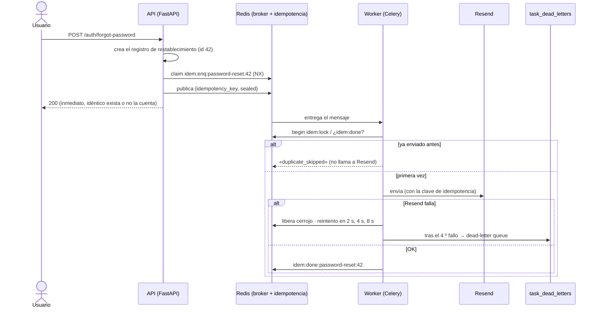

# Procesamiento asíncrono de operaciones con servicios externos

Ticket del CTO: *«No puedo seguir teniendo operaciones que dependen de un servicio externo ejecutándose dentro del mismo ciclo de petición-respuesta. Si ese servicio tarda o falla, quiero que la operación se reintente sola, sin perderse y sin que el usuario tenga que notar nada. Y si después de varios intentos sigue fallando, quiero saberlo.»*

## Qué operación se migró y por qué

**El email de «olvidé mi contraseña» (Resend)**, `POST /auth/forgot-password`.

| Antes | Ahora |
| --- | --- |
| Resend se llamaba dentro de la petición: si tardaba, el usuario esperaba | La petición solo encola y responde |
| Si Resend fallaba, el `except` lo tragaba con un `logger.exception`: **el email se perdía y nadie se enteraba** (la historia exacta del ticket) | Un worker lo reintenta con backoff; si se rinde, queda en la dead-letter queue |
| Sin protección frente a duplicados | Clave de idempotencia por operación |

Es el único servicio de terceros que el sistema llama de forma síncrona con un efecto que el usuario espera (la pasarela de pagos del ticket no existe en Brasaland). Además, el correo no puede perderse sin avisar: sin él, el usuario no recupera su cuenta.

> El análisis del CSV de incidencias ya usaba la cola (ticket anterior), pero es un cálculo interno, no un servicio externo; sigue igual.

## Flujo



## Contrato del mensaje (diseñado antes que el worker)

`services/async_tasks/contracts.py`:

```json
{ "idempotency_key": "password-reset:42", "sealed": "<Fernet({to, token})>" }
```

- `idempotency_key`: en claro. Identifica la operación.
- `sealed`: destinatario y token **cifrados** (Fernet; clave derivada de `TASK_PAYLOAD_KEY`, o de `JWT_SECRET_KEY` si no existe; API y worker comparten el `.env`). El token de restablecimiento es una credencial de un solo uso y el mensaje se guarda en Redis, por eso no va en claro. Caduca a la hora: un mensaje viejo se rechaza sin reintentos.
- El worker no necesita nada más para actuar de forma independiente (ni sesión, ni acceso a las bases de la API).
- Ni el token ni el correo aparecen en logs, resultado ni DLQ.

## Reintentos y resiliencia

| Parámetro | Valor |
| --- | --- |
| Reintentos máximos | 3 (4 ejecuciones) — `config.MAX_RETRIES` |
| Backoff | exponencial 2 s → 4 s → 8 s (base `TASK_RETRY_BASE_SECONDS`, tope `TASK_RETRY_MAX_SECONDS`) |
| Timeouts | soft 60 s / hard 90 s |
| ACK | tardío: si el worker muere, el mensaje vuelve a la cola |
| Dead-letter queue | tabla `task_dead_letters` (task_id, tarea, intento, error, fecha); `GET /tasks/dead-letters` (solo Admin) |
| Cola caída al encolar | no se pierde: se registra en la DLQ con `attempt=0` y log de error; la respuesta al usuario no cambia |

## Idempotencia

Tres claves en Redis por operación (`services/async_tasks/idempotency.py`):

| Clave | Protege frente a |
| --- | --- |
| `idem:enq:<key>` | encolar dos veces lo mismo (doble clic, reenvío del cliente): la segunda vez **no publica nada** y devuelve el mismo `task_id` (que además es determinista, `uuid5(key)`) |
| `idem:done:<key>` | el broker entrega el mismo mensaje dos veces (ACK tardío, visibility timeout): el worker lo ve como ya hecho y no repite el efecto |
| `idem:lock:<key>` | dos workers con el mismo mensaje a la vez: el segundo espera y reintenta |

Y la clave viaja también a Resend (`idempotency_key`): cubre el caso en que el worker envía el email pero muere antes de escribir `done`.

## Observabilidad

- `GET /tasks/{task_id}` → `{status: pending|started|success|failure, result, attempts}`. `attempts` = ejecuciones que tuvo la tarea (1 = a la primera; 4 = agotó los reintentos). `started` incluye «esperando el siguiente reintento».
- Logs por intento (`brasaland.tasks`): `task=email.send_password_reset task_id=… attempt=2 status=retry error=…`.
- Flower (puerto 5555) muestra la cola, las tareas en proceso, completadas y fallidas.

## Cómo probarlo

```bash
uv run --frozen --project services/api python -m pytest services/api/tests/test_async_email.py -q -p no:cacheprovider -W ignore --no-cov
# con un Redis y un worker reales (si hay redis-server instalado):
uv run --frozen --project services/api python -m pytest services/api/tests/test_async_tasks_redis.py -q -p no:cacheprovider -W ignore --no-cov
```

Evidencia de la prueba de idempotencia y del fallo simulado: [`evidence/async-processing-tests.txt`](evidence/async-processing-tests.txt).

## Despliegue

Nada nuevo en `docker-compose.yml`: `api` y `worker` ya comparten imagen, Redis y `.env` (por eso comparten `JWT_SECRET_KEY` y `RESEND_API_KEY`). Opcional: definir `TASK_PAYLOAD_KEY` propia. Si se cambia la clave con mensajes en cola, esos mensajes se rechazan y caen en la DLQ (es lo esperado: solo vivían una hora).

## Límites conocidos

- La idempotencia de Redis se apoya en TTL (7 días): una clave vieja podría repetirse pasado ese plazo (el token de restablecimiento caduca a los 30 minutos, así que no hay efecto real).
- Si Redis pierde datos (sin persistencia), se pierden también las marcas de idempotencia; el compose ya activa `appendonly` y `noeviction`.
- El listado de la DLQ no tiene «reintentar»: reencolar una tarea muerta es una decisión humana (el token ya habrá caducado).
