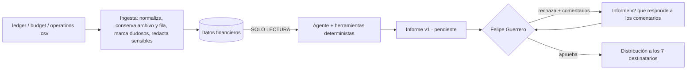

# Cierre financiero mensual

Un **único agente** (`agent:financial-close`) prepara el cierre de cada mes de Brasaland: ventas y gastos por país en moneda local, el total en USD,
desviaciones frente al presupuesto con una hipótesis sostenida por datos, y lo que falta, declarado. **Felipe Guerrero lo revisa antes de que llegue
a nadie.** Todo lo de este documento sale del briefing; las constantes viven en `data/pipelines/financial_close/config.py`.



## Estructura del informe (la del briefing)
1. **Resumen ejecutivo** (≤ 5 líneas) · 2. **Resultado consolidado en USD** (ingresos, gastos, resultado; real vs presupuesto, con el tipo de cambio usado) ·
3. **Resultado por país** en moneda local (todas las partidas) · 4. **Desviaciones relevantes** (una por partida: hipótesis + cifras que la sostienen) ·
5. **Datos faltantes o dudosos** · 6. **Anexo de trazabilidad** (cada cifra → sus `entry_id`).

## Herramientas de cálculo (deterministas, `Decimal`, con tests)
| Herramienta | Qué hace |
|---|---|
| `sum_amounts` | Suma importes; **falla** si hay monedas distintas sin convertir |
| `variance_abs` / `variance_pct` | Desviación absoluta y % exacto (sin redondear; `None` si el presupuesto es 0) |
| `is_relevant_deviation` | `|desv.| ≥ 5 %` sobre el valor exacto (4,999 % no se redondea a 5) |
| `pct_change` | Variación % de un indicador (cubiertos, ticket, precio, cantidad) |
| `convert_currency` / `to_usd` / `consolidate_usd` | COP↔USD a 1 USD = 4.000 COP; cada país se convierte **antes** de sumar |
| `parse_purchase` | Lee proveedor, precio unitario y cantidad de la descripción de una compra |
| `price_volume_effect` | Descompone la desviación en efecto precio + efecto cantidad (suma exacta) |

El modelo **no calcula nada**: las hipótesis son plantillas que reciben cifras ya calculadas (`TemplateNarrator`, punto de extensión para un LLM que solo vería datos redactados).
Dos cierres del mismo periodo con los mismos datos dan la misma huella (`content_hash`) y las mismas cifras.

## Trazabilidad
Cada cifra tiene un id (`FL.MKT.ACT`, `CONS.INC.ACT`…), su fórmula, sus componentes y los registros de origen. El anexo (sección 6) los lista; el revisor consulta el origen con
`GET /financial-close/reports/{id}/figures/{figure_id}` o desde la pantalla *Cierre financiero → Ver origen*. Los registros dudosos se **excluyen** de las cifras y se listan en la sección 5.

## Datos faltantes
Una partida con presupuesto y sin registros (Servicios de Florida) se declara **«SIN REGISTROS»**: no es 0 ni −100 %; los gastos y el resultado consolidados se marcan *parciales* y se comparan
contra el **presupuesto comparable** (solo las partidas con dato real). Una desviación relevante sin explicación en los datos (Marketing de Florida) dice que no hay explicación.

## Revisión y distribución
- Solo **Felipe Guerrero** aprueba o rechaza (ni siquiera un `admin` de la plataforma). Rechazar exige comentarios.
- Un rechazo crea **una versión nueva**: los comentarios que mencionan una partida amplían su detalle con los registros de origen; los que no se pueden atender automáticamente se **declaran como no atendidos**.
- Pendiente o rechazado → solo lo ve Felipe. Aprobado → se distribuye (una sola vez) a Mariana Restrepo, Felipe Guerrero, Nicolás Park, Lucía Fernández, Camila Ospina, Ashley Turner y Jake Morrison.

## Ejecución programada
Tercer día hábil de cada mes a las 06:00 hora de Medellín (`America/Bogota`). `schedule.tick(now)` es idempotente por periodo.
```bash
python -m data.pipelines.financial_close worker --source data/runtime/financial_close   # proceso en segundo plano (comprueba cada minuto)
python -m data.pipelines.financial_close demo                                          # CSV de ejemplo + informe v1
```
**Límite declarado:** los festivos colombianos son configurables (`config.HOLIDAYS`) pero vienen vacíos; sin ellos, «día hábil» = lunes a viernes.

## Seguridad y registro
- El agente tiene **identidad propia** y la base financiera se abre en **solo lectura** (`mode=ro`); intentar escribir falla. Herramientas prohibidas (`write_*`, `approve_report`, `distribute_report`) se deniegan y se registran.
- Toda acción del agente queda en `events` como **`automated_process`** (`agent:financial-close`, `scheduler`); las de personas como `user`.
- **Datos sensibles** (salarios individuales, datos bancarios de proveedores): se detectan y redactan en la ingesta (`[dato sensible omitido]`); una línea de nómina por persona se marca dudosa.
  Prueba automática: se inyectan en los CSV y se comprueba que no aparecen en registros, informes, eventos, mensajes, revisiones ni respuestas de la API.

## Ejemplos
- [`example-report.md`](./example-report.md): cierre completo de 2026-10 con su anexo de trazabilidad.
- [`example-report-incomplete.md`](./example-report-incomplete.md): mismo periodo con Marketing de Florida sin registros, indicadores de cubiertos ausentes y un registro con importe no numérico.
- [`design.md`](./design.md): diseño previo (estructura, herramientas, flujo).
