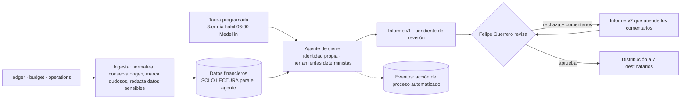

# Diseño previo al código · Cierre financiero mensual

Se diseñó **antes de programar** (pasos 5 y 6 de «Cómo empezar»). Todo lo concreto (cifras, umbral, revisor, destinatarios, hora) sale del BRIEFING y vive en `data/pipelines/financial_close/config.py`.

## Estructura del informe (la que fija el briefing)

| # | Sección | Contenido | Indicadores |
|---|---|---|---|
| 1 | Resumen ejecutivo | ≤ 5 líneas | resultado consolidado, desviaciones relevantes, lo que falta, estado de revisión |
| 2 | Resultado consolidado en USD | ingresos, gastos y resultado, real frente a presupuesto | desviación absoluta y % · TC usado (1 USD = 4.000 COP) |
| 3 | Resultado por país, en moneda local | todas las partidas, real frente a presupuesto | real, presupuesto, desviación abs. y %, nº de registros |
| 4 | Desviaciones relevantes (≥ 5 % a favor o en contra) | una por partida, con **hipótesis** y las cifras que la sostienen | cubiertos, ticket medio, precio unitario, cantidad |
| 5 | Datos faltantes o dudosos | partidas sin registros, registros dudosos excluidos, indicadores ausentes | — |
| 6 | Anexo de trazabilidad | para cada cifra, los `entry_id` (o fila de `budget.csv`/`operations.csv`) que la producen | — |

## Herramientas de cálculo (código determinista, `Decimal`, con pruebas)

| Herramienta | Qué hace |
|---|---|
| `sum_amounts` | suma importes de una sola moneda (**falla** si se mezclan monedas) |
| `variance_abs` / `variance_pct` | real − presupuesto y su % sobre el presupuesto (1 decimal, half-up) |
| `is_relevant_deviation` | `abs(desviación %) ≥ 5 %` (sin redondear antes) |
| `convert_currency` / `to_usd` | COP→USD al tipo de consolidación del briefing |
| `consolidate_usd` | convierte cada país por separado y suma ya en USD |
| `parse_purchase` | lee proveedor, precio unitario y cantidad de la descripción del registro |
| `price_volume_effect` | descompone una desviación de compras en efecto precio y efecto cantidad |
| `pct_change` | variación % de un indicador operativo |

## Flujo

