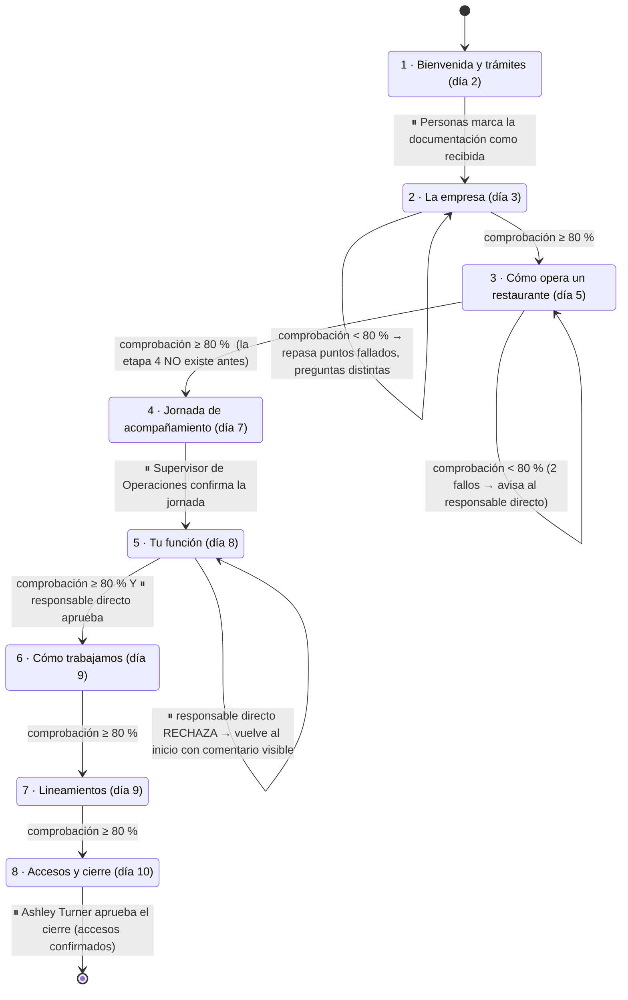

# Orquestador de onboarding corporativo

Agente único (LangGraph) que conduce a cada incorporación corporativa de Brasaland por las 8 etapas del BRIEFING, con estado persistente,
comprobaciones de comprensión, aprobaciones humanas reales y seguimiento de plazos.

- Código: `data/pipelines/onboarding/` · API: `services/api/app/onboarding/` · UI: `uis/backoffice/app/onboarding`
- Material oficial: `docs/onboarding-knowledge-base/` (5 documentos de contenido; la etapa 5 con 3 variantes de puesto) + bancos de preguntas en `quizzes/`
- Semillas: `python -m data.pipelines.onboarding seed` (o `ONBOARDING_SEED=1` al arrancar la API)

## Grafo de etapas



Nodos del grafo LangGraph: `enter_stage → quiz_prepare → await_quiz (interrupt) → reinforce | advance`, `await_approval (interrupt) → advance | enter_stage (rechazo)`, `finish`.
Cada ⏸ es un `interrupt()` real: el hilo queda guardado en el checkpointer y no avanza hasta que llega una decisión validada.

| # | Etapa | Condición de salida | Plazo | Aprueba | Comprobación |
|---|-------|---------------------|-------|---------|--------------|
| 1 | Bienvenida y trámites | Personas marca la documentación como recibida | día 2 | Equipo de Personas (dept. Personas) | no |
| 2 | La empresa | Comprobación superada | día 3 | automática | sí |
| 3 | Cómo opera un restaurante | Comprobación superada | día 5 | automática | sí |
| 4 | Jornada de acompañamiento | Un supervisor de Operaciones confirma la jornada | día 7 | Supervisor de Operaciones | no |
| 5 | Tu función | Comprobación superada y aprobación del responsable directo | día 8 | Responsable directo de ESA persona | sí |
| 6 | Cómo trabajamos | Comprobación superada | día 9 | automática | sí |
| 7 | Lineamientos | Comprobación superada | día 9 | automática | sí |
| 8 | Accesos y cierre | Ashley aprueba el cierre | día 10 | Ashley Turner | no |

Plazos en días hábiles desde la fecha de inicio, a las 18:00 de la sede (Medellín = America/Bogota, Miami = America/New_York).

## ¿Por qué UN solo agente? (justificación del monoagente)

1. **Un único proceso con estado, no varias especialidades.** El recorrido es una secuencia con una máquina de estados explícita; no hay subtareas
   que requieran roles distintos de razonamiento en paralelo. Lo que cambia entre etapas son los datos (contenido, banco de preguntas, aprobador), no la capacidad del agente.
2. **El coste de coordinar supera el beneficio.** Varios agentes (uno por etapa, uno de dudas, uno de plazos) exigirían pasarse el estado de la
   persona, duplicar el control de qué etapa toca y sincronizar quién es dueño del hilo: más puntos de fallo en un flujo que dura 10 días hábiles.
3. **Auditoría y reanudación simples.** Un hilo (`onboarding-{id}`) = una incorporación = un checkpoint. Tras un reinicio hay una sola verdad a la que volver.
4. **Seguridad por estrechez.** Un solo conjunto de permisos mínimos es más fácil de razonar y de probar que la matriz de varios agentes.
5. **Lo «inteligente» está acotado.** Las dudas se resuelven por recuperación TF-IDF extractiva sobre los documentos oficiales (cita la sección o deriva) y las
   comprobaciones se corrigen con claves cerradas: no hay generación libre que justifique agentes especializados ni riesgo de inventar contenido oficial.
6. Cuándo cambiaría: si aparecieran flujos distintos que compartan infraestructura (p. ej. onboarding de restaurante) o tareas largas que deban correr en paralelo
   dentro de una misma persona, se separarían en agentes con un supervisor.

Varias incorporaciones sí corren **en paralelo**: cada una tiene su hilo y su estado aislados, y hay un cerrojo por incorporación (no global).

## Herramientas del agente (la lista más corta posible)

| Permiso | Para qué |
|---------|----------|
| `read_onboarding_state` | leer en qué etapa está y qué espera |
| `present_content` | presentar el material oficial adaptado a puesto/sede |
| `consult_documents` | responder dudas SOLO con el material oficial, citando fuente |
| `grade_comprehension` | corregir la comprobación contra claves cerradas |
| `notify` | recordatorios y escalados mediante plantillas del flujo (no mensajes libres) |
| `record_stage_status` | anotar el estado de la etapa (no su contenido sensible) |

**Herramientas que el agente NO tiene (`AGENT_FORBIDDEN`)**: aprobar o rechazar etapas, leer o escribir datos sensibles, enviar mensajes libres,
modificar el directorio de personas, leer otros sistemas. Tiene identidad propia (`agent:onboarding-orchestrator`), distinta de cualquier persona; toda
acción pasa por `AgentIdentity.act`, que exige el permiso y registra el evento como `automated_process`.

## Aprobaciones

La decisión se valida ANTES de tocar el checkpoint (`check_decision`) comprobando **rol y departamento** del aprobador contra el directorio de Personas:

- Etapa 1: dept. Personas con rol equipo/manager de Personas · Etapa 4: dept. Operaciones con rol supervisor · Etapa 5: SOLO el responsable directo de esa persona ·
  Etapa 8: Ashley (People Manager).
- Ser `admin` de la plataforma no concede poder de aprobación. Rechazo sin comentario → 422. Aprobar etapa 1 exige contrato y nómina marcados como recibidos; etapa 8, accesos confirmados.

## Plazos, recordatorios y escalados (`sweep`)

Recordatorio a la persona a ≤24 h del plazo · aviso al responsable directo cuando la etapa vence · aviso a Ashley al superar 3 días hábiles de retraso acumulado.
Cada aviso se emite una sola vez por etapa. `POST /onboarding/sweep` (o `python -m data.pipelines.onboarding sweep`, apto para cron) lo ejecuta.

## Datos sensibles

Documento de identidad, datos bancarios y salario **no se almacenan**: solo flags de estado (`contract_received`, `payroll_docs_received`, `accesses_confirmed`).
Todo texto libre (dudas, comentarios, detalles de eventos, avisos) pasa por `redact()` antes de persistirse; los eventos del agente solo guardan metadatos.
Prueba: `test_sensitive_data_never_reaches_logs_store_checkpoint_or_notifications` recorre BD, checkpoint, logs y vistas buscando los valores inyectados.

## Ejemplo de duda fuera de alcance, bien derivada

> Persona: «¿Cuántos días de vacaciones me corresponden?»
> Agente: «El material oficial de onboarding no cubre esa duda, así que no voy a inventar una respuesta. He dejado tu pregunta para Personas (Ashley Turner), que te responderá.»
> → `answered: false`, `sources: []`, `derived_to: "Personas (Ashley Turner)"`, y Ashley recibe el aviso `question_derived`.

Contraste, con fuente: «¿Cuándo se hace el pedido semanal?» → «Cada gerente de local genera el pedido semanal a proveedores los lunes…» · Fuente: `etapa-3-como-opera-un-restaurante#pedidos-de-ingredientes`.

## Reanudación tras reinicio

Checkpointer SQLite (`ONBOARDING_CHECKPOINT_DB`) o PostgreSQL (`ONBOARDING_CHECKPOINT_BACKEND=postgres`). La verdad de «qué espera el agente» se lee del checkpoint (`engine.awaiting`),
no de memoria. Prueba: `test_restart_resumes_exactly_at_the_same_stage` crea un motor, avanza hasta un intento fallido de la etapa 3, lo descarta, levanta otro sobre los mismos ficheros y comprueba
estado, intento y preguntas idénticos; luego continúa a la etapa 4.

## Operación

```bash
python -m data.pipelines.onboarding seed     # 3 incorporaciones, 6 personas del directorio
python -m data.pipelines.onboarding board
python -m data.pipelines.onboarding sweep    # programar con cron cada hora
```
Variables: `ONBOARDING_DB`, `ONBOARDING_CHECKPOINT_DB`, `ONBOARDING_CHECKPOINT_BACKEND`, `ONBOARDING_SEED`.
