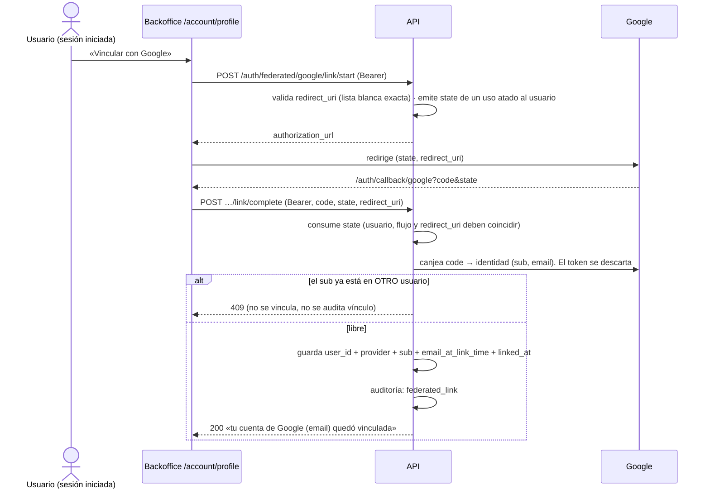
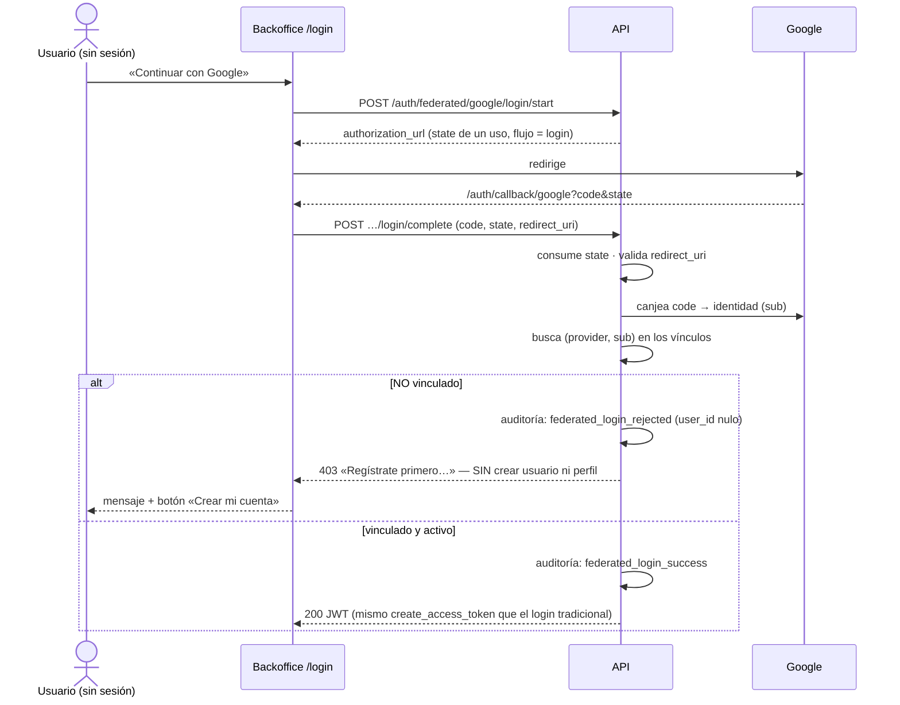

# Autenticación federada (Google)

Regla del CTO: **el login federado solo entra en una cuenta que ya existe y que el propio usuario vinculó desde su perfil.**
Nunca crea cuentas. Proveedor obligatorio: **Google** (OAuth 2.0 / OIDC). Apple es opcional y no se ofrece.

## Los dos flujos (comparten proveedor, no lógica)

### 1 · Vincular (solo con sesión iniciada, desde el perfil)



### 2 · Login federado (solo cuentas ya vinculadas)



## Modelo de datos (solo el vínculo, nunca la sesión de Google)

| Campo | Regla |
| --- | --- |
| `user_id` | usuario de Brasaland |
| `provider` | `google` |
| `provider_user_id` | `sub` de Google; **único junto con `provider`** (se comprueba y se inserta bajo el mismo cerrojo) |
| `email_at_link_time` | instantánea informativa; **no** es la clave de identidad |
| `linked_at` | fecha de vinculación (sistema) |

Un usuario puede tener 0, 1 o varios proveedores (una cuenta por proveedor). No se persiste ningún access/refresh token de Google:
el token del canje se usa una vez para leer `sub` y email, y se descarta.

## Seguridad

- **`state`**: aleatorio (256 bits), guardado en servidor, **de un solo uso**, caduca a los 10 min y va atado al flujo (vincular/login), al `redirect_uri` y, al vincular, al **usuario con sesión**. Repetirlo, caducado, de otro usuario o de otro flujo → 400.
- **`redirect_uri`**: lista blanca por **coincidencia exacta** (`OAUTH_REDIRECT_URI` + `OAUTH_ALLOWED_REDIRECT_URIS`). Se valida al iniciar y de nuevo al completar, y debe ser el mismo del `state`.
- **Sesión**: el login federado emite el mismo JWT (`create_access_token`), con la misma caducidad; se revoca igual (desactivar al usuario invalida la sesión). Rate limit por IP como el login tradicional.
- **Sin cuenta por acceso externo**: no existe ruta que cree usuarios desde Google. El rechazo no deja filas.
- **Desvincular**: si Google es el único método de acceso (sin contraseña ni otro proveedor) la API responde 409 y la interfaz avisa. Una cuenta sin contraseña no puede entrar por `/auth/login` (401, no 500).
- **Dispositivos compartidos**: `FEDERATED_AUTH_ENABLED=false` en el despliegue de las tablets de los locales apaga el login federado (la API responde 403 y la interfaz no muestra el botón). Se vincula solo desde el perfil, pensado para personal corporativo y clientes.
- Al eliminar un usuario se borran sus vínculos (así una identidad no queda huérfana).

## Auditoría

Tabla solo de altas (`audit_events.json`) y log `brasaland.audit`. Cada evento: `timestamp`, `user_id` (nulo en rechazo), `provider`, `provider_user_id`, `ip`.

| `event` | Cuándo |
| --- | --- |
| `federated_link` | proveedor vinculado desde un perfil autenticado |
| `federated_unlink` | proveedor desvinculado |
| `federated_login_success` | login con un proveedor ya vinculado |
| `federated_login_rejected` | login con un proveedor no vinculado (o cuenta desactivada) |

Consulta (solo Admin): `GET /audit/events?event=…&user_id=…`.

## Endpoints

| Método y ruta | Sesión | Qué hace |
| --- | --- | --- |
| `GET /auth/federated/providers` | no | qué botones mostrar (respeta el interruptor del despliegue) |
| `GET /auth/federated` | sí | proveedores vinculados, si tiene contraseña y nº de métodos de acceso |
| `POST /auth/federated/{provider}/link/start` · `/link/complete` | **sí** | vincular |
| `DELETE /auth/federated/{provider}` | **sí** | desvincular |
| `POST /auth/federated/{provider}/login/start` · `/login/complete` | no | entrar (solo cuentas vinculadas) |
| `GET /audit/events` | Admin | consultar la auditoría |

## Configuración

```bash
GOOGLE_CLIENT_ID=...
GOOGLE_CLIENT_SECRET=...
OAUTH_REDIRECT_URI=http://localhost:3000/auth/callback/google
# otros redirect_uri permitidos (coincidencia exacta), p. ej. el de Codespaces:
# OAUTH_ALLOWED_REDIRECT_URIS=https://<codespace>-3000.app.github.dev/auth/callback/google
```

En Google Cloud Console: credenciales → ID de cliente OAuth (aplicación web) → añade cada `redirect_uri` en «URI de redireccionamiento autorizados».

## Dónde está (alcance)

El backoffice es la única app con cuentas hoy: ahí están el botón de login, el panel «Cuentas vinculadas» del perfil y el callback.
La app de clientes (Brasa Points) reutilizará los mismos endpoints cuando tenga login propio.

## Datos semilla

`python -m app.access.seed` (o `SEED_DEMO_DATA=1`) añade `camila.points@brasaland.example` (con Google `google-sub-camila-001`) y
`guest.unlinked@brasaland.example` (sin vincular). `google-sub-unknown-999` es la identidad del login rechazado.

## Evidencia

- `docs/security/evidence/federated-auth-rechazo.txt`: login con proveedor no vinculado → 403, sin cuentas nuevas, auditado.
- `docs/security/evidence/federated-auth-tests.txt`: `pytest -v services/api/tests/test_federated_auth.py`.
