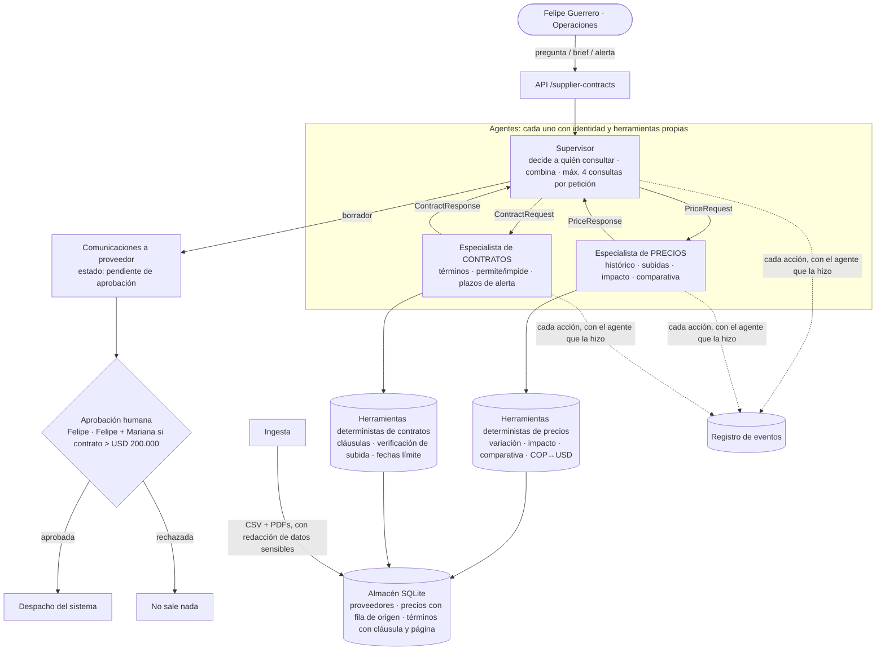

# Gestión de proveedores y contratos (Agentic Engineering)

> Un **supervisor** coordina a un **especialista de precios** y a un **especialista de contratos** que se necesitan mutuamente: el precio dice *qué* ha pasado y *cuánto cuesta*; el contrato dice *si estaba permitido* y *qué margen y salidas hay*. Solo juntos dan una respuesta que Operaciones pueda usar para renegociar.

Stakeholder: Felipe Guerrero (Director de Operaciones). **Requiere sign-off de la dirección de Operaciones antes del merge.**

## 1. Arquitectura (dibujada antes de programar)



### Qué hace cada pieza

| Pieza | Responsabilidad | Herramientas (solo las suyas) | NO puede |
|---|---|---|---|
| Supervisor | Recibe la petición, decide a quién consultar, combina en UNA respuesta, redacta borradores | `consult_price_specialist`, `consult_contract_specialist`, `compose_answer`, `draft_communication` | calcular, leer PDFs, enviar nada |
| Especialista de precios | Histórico por proveedor/producto, subidas sobre umbral, impacto, comparativa del mismo país y categoría | `read_prices`, `detect_increase`, `compute_impact`, `compare_peers`, `convert_currency` | leer contratos, enviar nada |
| Especialista de contratos | Qué permite o impide el contrato citando cláusula y página; fechas límite | `read_contract_terms`, `check_price_increase`, `compute_deadlines`, `convert_currency` | leer precios, enviar nada |

### Contratos de entrada y salida (detalle en la sección 3 del README)

Los modelos están en `data/pipelines/supplier_contracts/schemas.py` y son la única forma de hablar entre agentes: los especialistas no se
conocen entre sí (no hay bucles posibles) y el supervisor tiene además un tope de consultas por petición.

- `PriceRequest{action, supplier_id, as_of, compare_with?}` → `PriceResponse{status, increase, history[Fact], peers[PeerQuote], notes, missing}`
- `ContractRequest{action, supplier_id, as_of, increase_pct?}` → `ContractResponse{status, terms[Term], verdict, deadlines[Deadline], citations[Citation], missing}`
- `Fact`/`IncreaseInfo`/`PeerQuote` llevan `SourceRef{file, row}` · `Citation{contract_id, clause, page, quote, language, confidence, doubtful}`
- `SupervisorReply{intent, answer, consulted, consults_used, consults_limit, facts, citations, missing, truncated, brief}`

### Reglas transversales

1. **Nada de aritmética del modelo**: todo cálculo es código determinista con `Decimal` y pruebas.
2. **Trazabilidad**: cada cifra → fila del CSV; cada afirmación contractual → cláusula + página + cita en el idioma del contrato.
3. **Lo que no existe se declara** (`missing`): sin contrato, sin cláusula de preaviso, sin alternativa en el mismo país…
4. **El sistema prepara, las personas deciden**: las comunicaciones nacen `pending_approval`; ningún agente tiene permiso de envío.
5. **Datos sensibles** (cuentas bancarias y contacto personal de los contratos) se redactan en la ingesta: no llegan a BD, logs, mensajes ni API.

Código: `data/pipelines/supplier_contracts/` · API: `services/api/app/supplier_contracts/routes.py` · UI: `/supplier-contracts` (backoffice).

## 2. Por qué multiagente (y no un solo agente)

1. **Dos competencias distintas con herramientas distintas.** Precios trabaja con series numéricas y cálculo; contratos con texto legal en dos idiomas, cláusulas y páginas. Mezclarlas en un solo agente le daría acceso a todo y haría imposible demostrar «el agente de precios nunca lee un contrato».
2. **Mínimo privilegio comprobable.** Cada agente tiene su identidad (`agent:price-specialist`, `agent:contract-specialist`, `agent:supplier-supervisor`) y solo las herramientas de su especialidad; lo demás se deniega y se registra (`tests/pipelines/test_supplier_contracts.py::test_a_specialist_cannot_use_another_specialists_tool_and_it_is_logged`). Ningún agente tiene herramienta de enviar ni de aprobar.
3. **Contratos de entrada/salida explícitos** (`schemas.py`): los especialistas solo se hablan a través del supervisor con modelos tipados; no hay bucles posibles entre ellos y el supervisor limita las consultas por petición (**4**).
4. **Dependencia real entre ambos**: la pregunta «¿está permitida esta subida?» exige primero el % de subida (precios) y luego el tope de la cláusula (contratos). El brief necesita además el impacto, la comparativa, la cláusula de salida y los plazos. Ninguno de los dos puede responder solo.
5. **Auditable por agente**: cada acción queda en `events` con el agente que la realizó y cada mensaje entre agentes en `messages` (ya redactado).
6. **Qué NO se hizo multiagente**: los cálculos. Son funciones deterministas con `Decimal` (`tools.py`), cubiertas por pruebas; el modelo —aquí, el código de enrutado y redacción— nunca hace aritmética.

## 3. Contratos de entrada y salida de cada especialista

### Especialista de PRECIOS
| | |
|---|---|
| Entrada `PriceRequest` | `action` (`history` · `detect_increase` · `peers` · `full_report`), `supplier_id`, `as_of`, `compare_with?` (otro proveedor de otro país, solo comparación orientativa) |
| Salida `PriceResponse` | `status` (`ok` · `no_data` · `not_found`), `increase{previous_price, current_price, pct, threshold_pct, exceeds, monthly_volume, monthly_impact, monthly_impact_usd, annualized_impact, sources[]}`, `history[Fact]`, `peers[PeerQuote]`, `notes`, `missing` |
| Herramientas | `read_prices`, `detect_increase`, `compute_impact`, `compare_peers`, `convert_currency` |
| Trazabilidad | cada `Fact`/`IncreaseInfo`/`PeerQuote` lleva `SourceRef{file, row}` (la fila del CSV, la 1 es la cabecera) |
| Declara | proveedor inexistente · sin histórico · menos de 2 meses · sin volumen (solo cotización) · sin otro proveedor del mismo país y categoría · unidades no comparables |

### Especialista de CONTRATOS
| | |
|---|---|
| Entrada `ContractRequest` | `action` (`terms` · `evaluate_increase` · `deadlines` · `notice`), `supplier_id`, `as_of`, `increase_pct?` (la entrega el supervisor: el especialista no conoce los precios) |
| Salida `ContractResponse` | `status` (`ok` · `no_contract` · `not_found`), `contract_id`, `annual_value(+_usd)`, `exit_penalty_estimate`, `terms[Term]`, `verdict{verdict, allowed_max_pct, reasons, pending_conditions}`, `deadlines[Deadline]`, `citations[Citation{contract_id, clause, page, quote, language, confidence, doubtful}]`, `missing` |
| Herramientas | `read_contract_terms`, `check_price_increase`, `compute_deadlines`, `convert_currency` |
| Trazabilidad | toda afirmación → `Citation` con contrato, **cláusula y página**, cita literal en el **idioma del contrato** y confianza de la extracción |
| Declara | proveedor sin contrato · contrato sin cláusula de preaviso / revisión · extracción de baja confianza (`doubtful`, nunca se usa como firme) · avisos o pruebas sin registro |

### SUPERVISOR
Entrada: pregunta en lenguaje natural (`/supplier-contracts/ask`) o proveedor para brief (`/brief`). Salida `SupervisorReply{intent, answer, consulted[], consults_used, consults_limit, facts[], citations[], missing[], truncated, brief}`. Intenciones: `permitted`, `cost`, `alternative`, `notice_deadline`, `notice_period`, `summary`, `brief`. Herramientas: `consult_price_specialist`, `consult_contract_specialist`, `compose_answer`, `draft_communication`.

## 4. Extracción y trazabilidad

* **Precios**: `price_history.csv` (12 meses, 8 proveedores, columnas del briefing). Al ingerir se guardan `source_file` y `source_row`.
* **Contratos PDF** (ficticios, generados y leídos con `pdfplumber`): cada término es una cláusula numerada; se extrae vencimiento, preaviso de renovación/no renovación, revisión de precio, salida y penalización y valor anual, cada uno con **cláusula, página, cita, confianza**. Confianza < 0,70 → `doubtful` (revisión manual; el veredicto pasa a «indeterminado»).
* Las fechas de los contratos son **relativas a la fecha de carga** (hoy + 120/75/200/20 días).

## 5. Ejemplo: una subida detectada y evaluada contra su contrato (escenario A)

Fecha de carga 2026-11-25. Alerta generada automáticamente:

> Sunshine Prime Meats subió 12,00% (7,2000 → 8,0640 USD/lb), por encima del umbral del 3%: NO permitida por el contrato; impacto ≈ 2.073,60 USD/mes.

Pregunta: *«¿La subida de Sunshine Prime Meats está permitida por el contrato?»* → el supervisor consulta a precios (subida 12 %, 7,2000 → 8,0640 USD/lb, filas 36 y 37) y luego a contratos con `increase_pct=12`:

```
Sunshine Prime Meats subió 12,00% (7,2000 → 8,0640 USD/lb; price_history.csv fila 36; price_history.csv fila 37); supera el umbral del 3%.

**NO, el contrato no la permite.**
- Según la cláusula 4, p. 2 el precio es FIJO durante la vigencia; solo puede subir si el índice de referencia de carne de res sube más de un 10% en el trimestre, con preaviso escrito de 30 días.
- No hay registro de la prueba del índice de referencia (el sistema no la tiene; no se estima).
- No hay registro del preaviso escrito.

Cláusulas:
- CT-BR-02, cláusula 4, p. 2 (EN): «Price review. Prices are fixed during the term, unless the reference beef index rises more than 10% in the quarter, subject to 30 days' written notice.»
```

Cómo se llega a «no»: la cláusula 4 (p. 2) fija el precio **durante la vigencia**; solo permite subirlo si el índice de carne de res sube más de un 10 % en el trimestre **y** hay preaviso escrito de 30 días. El sistema no tiene ni la prueba del índice ni el aviso (`notices` vacío) y **no los estima**. Si Compras registra ambos (`POST /supplier-contracts/notices`), el veredicto cambia (`test_scenario_a_changes_only_with_both_notice_and_index_evidence`).

Los otros tres escenarios del briefing (tests `test_scenario_*`):

| Escenario | Proveedor | Subida | Umbral | Contrato | Veredicto |
|---|---|---|---|---|---|
| A | Sunshine Prime Meats | +12 % | 3 % (res) | CT-BR-02 cl. 4 p. 2: precio fijo salvo índice > 10 % + preaviso escrito | **No permitida** (sin prueba ni aviso) |
| B | Carnes del Valle | +4 % | 3 % (res) | CT-BR-01 cl. 4 p. 2: IPC 5,2 % + 1 punto = 6,2 % | **Permitida** (margen 2,2 puntos); condiciones pendientes declaradas: preaviso escrito de 30 días y fecha de la última revisión semestral |
| C | Avícola Antioquia | +9 % | 8 % | CT-BR-03 cl. 4 p. 2: máximo anual 5 % | **No permitida** (excede el máximo) |
| D | Brava Beverages FL | +6 % | 8 % | CT-BR-04 cl. 4: precio libre | Sin alerta de precio; sí alerta de vencimiento (20 días) |

Alertas generadas a la fecha de carga (a Lucía Fernández y Felipe Guerrero):

| Tipo | Proveedor | Mensaje |
|---|---|---|
| price_increase | BR-S01 | Carnes del Valle S.A.S. subió 4,00% (38.000 → 39.520 COP/kg), por encima del umbral del 3%: PERMITIDA por el contrato (2 condición(es) pendiente(s) de verificar); impacto ≈ 4.256.000,00 COP/mes (≈ USD 1.064,00). |
| price_increase | BR-S02 | Avícola Antioquia subió 9,00% (11.500 → 12.535 COP/kg), por encima del umbral del 8%: NO permitida por el contrato; impacto ≈ 4.398.750,00 COP/mes (≈ USD 1.099,69). |
| price_increase | BR-S05 | Sunshine Prime Meats subió 12,00% (7,2000 → 8,0640 USD/lb), por encima del umbral del 3%: NO permitida por el contrato; impacto ≈ 2.073,60 USD/mes. |
| contract_expiry | BR-S05 | El contrato CT-BR-02 con Sunshine Prime Meats vence el 2027-02-08 (en 75 días); alerta de 90 días. |
| contract_expiry | BR-S08 | El contrato CT-BR-04 con Brava Beverages FL vence el 2026-12-15 (en 20 días); alerta de 30 días. |
| notice_deadline | BR-S08 | La fecha límite de preaviso del contrato CT-BR-04 con Brava Beverages FL es el 2026-11-30 (en 5 días). |

## 6. Brief de renegociación con su trazabilidad (Sunshine Prime Meats)

Generado por `POST /supplier-contracts/brief` (supervisor → precios `full_report` + contratos `evaluate_increase`; 2 consultas de 4 permitidas). Cada cifra remite a su fila del CSV y cada afirmación contractual a su cláusula y página; la última sección lista la trazabilidad.

### Brief de renegociación — Sunshine Prime Meats (BR-S05)
_Carne de res · Estados Unidos · USD · datos a 2026-11-25_

#### 1. Qué ha pasado
Sunshine Prime Meats pasó de 7,2000 a 8,0640 USD/lb (**12,00%** en 2026-11); supera el umbral del 3% (price_history.csv fila 36; price_history.csv fila 37).

#### 2. Histórico de 12 meses
| Mes | Precio | Fuente |
|---|---|---|
| 2025-12 | 7,2677 USD/lb | price_history.csv fila 26 |
| 2026-01 | 7,2503 USD/lb | price_history.csv fila 27 |
| 2026-02 | 7,3025 USD/lb | price_history.csv fila 28 |
| 2026-03 | 7,2652 USD/lb | price_history.csv fila 29 |
| 2026-04 | 7,2362 USD/lb | price_history.csv fila 30 |
| 2026-05 | 7,1718 USD/lb | price_history.csv fila 31 |
| 2026-06 | 7,2155 USD/lb | price_history.csv fila 32 |
| 2026-07 | 7,2559 USD/lb | price_history.csv fila 33 |
| 2026-08 | 7,2719 USD/lb | price_history.csv fila 34 |
| 2026-09 | 7,2137 USD/lb | price_history.csv fila 35 |
| 2026-10 | 7,2000 USD/lb | price_history.csv fila 36 |
| 2026-11 | 8,0640 USD/lb | price_history.csv fila 37 |

Mínimo 7,1718 · máximo 8,0640 USD/lb.

#### 3. Impacto económico
**2.073,60 USD al mes** (≈ USD 2.073,60) y 24.883,20 USD al año: (8,0640 − 7,2000) × 2.400 lb/mes (price_history.csv fila 36; price_history.csv fila 37).

#### 4. Comparación con otros proveedores de Carne de res en Estados Unidos
- Gulf Coast Beef Co.: 7,0479 USD/lb (más barato 12,60%; price_history.csv fila 49) — **cotización**, sin compras ni contrato; ahorro estimado al volumen actual: 2.438,64 USD/mes

#### 5. Qué dice el contrato
**La subida NO está permitida por el contrato.**
- Según la cláusula 4, p. 2 el precio es FIJO durante la vigencia; solo puede subir si el índice de referencia de carne de res sube más de un 10% en el trimestre, con preaviso escrito de 30 días.
- No hay registro de la prueba del índice de referencia (el sistema no la tiene; no se estima).
- No hay registro del preaviso escrito.

**Salida del contrato:**
- Salida anticipada: penalización de 2 meses de compra media (≈ 34.560,00 USD, estimado como valor anual ÷ 12 × 2) (cláusula 5, p. 2).
- Vencimiento: 2027-02-08 (en 75 días; cláusula 2, p. 1).
- Fecha límite de preaviso: 2026-12-25 (en 30 días; cláusula 3, p. 2).

Cláusulas citadas (idioma original):
- CT-BR-02, cláusula 4, p. 2 (EN): «Price review. Prices are fixed during the term, unless the reference beef index rises more than 10% in the quarter, subject to 30 days' written notice.»
- CT-BR-02, cláusula 5, p. 2 (EN): «Early termination. Early termination carries a penalty of 2 months of average purchases.»

#### 6. Recomendación
**Rechazar la subida y pedir su retirada**: el contrato no la ampara. Palanca: Gulf Coast Beef Co. cotiza más barato. Ojo con la fecha límite de preaviso (2026-12-25, en 30 días): si no se avisa a tiempo el contrato puede renovarse.

#### 7. Aprobación necesaria antes de contactar al proveedor
Aprueban: Felipe Guerrero y Mariana Restrepo (contrato de ≈ USD 207.360 al año > USD 200.000). El sistema solo prepara el borrador; **nada sale sin su visto bueno.**

#### Trazabilidad de cifras y cláusulas
- Precio anterior 7.2000 ← price_history.csv fila 36
- Precio actual 8.0640 ← price_history.csv fila 37
- Impacto mensual 2073.60 USD ← price_history.csv fila 36; price_history.csv fila 37 (volumen 2400)
- Precio de Gulf Coast Beef Co. 7.0479 ← price_history.csv fila 49
- Cláusula de salida ← CT-BR-02 cláusula 5, p. 2
- CT-BR-02: Price review. Prices are fixed during the term, unless the r… ← cláusula 4, p. 2

## 7. Respuestas a las preguntas del briefing

| Pregunta | Qué hace el sistema |
|---|---|
| ¿La subida de Sunshine está permitida por el contrato? | Precios → contratos; **no** (cláusula 4, p. 2) |
| ¿Cuánto nos cuesta al mes la subida de Avícola Antioquia? | Solo precios: (12.535 − 11.500) × 4.250 kg = **4.398.750 COP/mes** (filas 60 y 61) |
| ¿Qué alternativa tenemos a Carnes del Valle y a qué precio? | Precios: Frigorífico Andino (misma categoría y país), declarado como **cotización** |
| ¿Cuándo hay que avisar a Sunshine si no queremos renovar? | Contratos: vencimiento − 45 días (cláusula 3, p. 2) |
| ¿Cuál es el preaviso de Avícola Antioquia? | **El contrato no lo especifica** (no hay cláusula de preaviso); no se supone |
| ¿Qué dice el contrato de Hortalizas La Sabana? | **No hay contrato** (compra por pedido) |
| Prepárame un brief para renegociar con Sunshine | Brief de la sección 6 |

Comparar Colombia con Florida (p. ej. «Compara Carnes del Valle con Sunshine Prime Meats») convierte a USD/kg al tipo de cambio de referencia (1 USD = 4.000 COP) y avisa: *mercados distintos, comparación solo orientativa*.

## 8. Umbrales, alertas y aprobadores (exactos del briefing)

| Regla | Valor |
|---|---|
| Subida de precio, carne de res | > 3 % frente al mes anterior |
| Subida de precio, resto de categorías | > 8 % |
| Vencimiento de contrato | 90 y 30 días antes |
| Fecha límite de preaviso | 15 días antes (CT-BR-03 no tiene cláusula de preaviso: no se genera alerta ni se supone fecha) |
| Destinatarios de alertas | Lucía Fernández (Compras) y Felipe Guerrero |
| Cualquier comunicación a un proveedor | Felipe Guerrero |
| Contrato con valor anual > USD 200.000 (o equivalente en COP) | Felipe Guerrero **y** Mariana Restrepo (CT-BR-01 ≈ USD 319.200 y CT-BR-02 USD 207.360) |

Idioma base: **español** (respuestas, briefs, alertas). Las citas de cláusulas se reproducen en el idioma del contrato (ES para Colombia, EN para Florida).

## 9. El sistema prepara, las personas deciden

* El supervisor **redacta** el borrador (`draft_communication`); nace `pending_approval`. Ningún agente tiene herramienta de aprobar ni de enviar (`FORBIDDEN_FOR_AGENTS`).
* `POST /communications/{id}/decision`: solo la persona con el rol exigido (identidad por directorio, no por `admin` de plataforma); aprobar dos veces o por un rol no exigido → error; un rechazo es definitivo.
* `POST /communications/{id}/send`: solo Felipe y solo si **todas** las aprobaciones exigidas constan. El envío queda registrado; **la integración real de correo no está conectada en este proyecto** (nada sale a un proveedor).

## 10. Datos sensibles

| Dato | Dónde aparece | Tratamiento |
|---|---|---|
| Datos bancarios del proveedor (cuenta, routing, titular) | cláusula de facturación de cada contrato de prueba | la cláusula se descarta **entera** al ingerir; además `redact()` sustituye cualquier cuenta residual |
| Teléfono y correo **personales** de la persona de contacto | misma cláusula | ídem (teléfonos y correos externos; los `@brasaland-demo.com` del directorio interno no son datos de contacto de proveedores) |

Prueba: `test_sensitive_data_never_reaches_db_logs_messages_answers_briefs_or_drafts` (núcleo) y `test_no_endpoint_ever_returns_sensitive_contract_data` (API). Buscan los 15 valores ficticios sembrados en los PDFs dentro del **fichero SQLite en bruto**, las tablas (términos, eventos, mensajes entre agentes, alertas, comunicaciones), los logs capturados, todas las respuestas del supervisor y del brief y todas las respuestas de la API: no aparece ninguno. No hay modelo de lenguaje en este flujo (enrutado y redacción deterministas), por lo que no hay *prompts* almacenados; si se añadiera una capa de redacción con LLM, solo recibiría los modelos ya redactados.

## 11. Cómo ejecutarlo

```bash
python -m data.pipelines.supplier_contracts seed      # genera los PDFs + CSV en data/runtime y los ingiere
python -m data.pipelines.supplier_contracts alerts
python -m data.pipelines.supplier_contracts ask "¿Cuál es el preaviso de Avícola Antioquia?"
python -m data.pipelines.supplier_contracts brief BR-S05
# API: SUPPLIER_CONTRACTS_SEED=1 (carga al arrancar) o POST /supplier-contracts/seed · UI: /supplier-contracts
PYTHONPATH=. uv run python -m pytest tests/pipelines/test_supplier_contracts.py
```

Variables: `SUPPLIER_CONTRACTS_DB`, `SUPPLIER_CONTRACTS_DATA_DIR`, `SUPPLIER_CONTRACTS_SEED`.

## 12. Límites conocidos (declarados)

* El directorio de personas (Felipe, Mariana, Lucía) es de **prueba**: en producción vendría de Personas.
* La «compra media» de la penalización de CT-BR-02 se estima como valor anual ÷ 12 × 2 (cláusula 6, p. 3); se declara como estimación en el brief.
* El registro de avisos escritos y pruebas del índice es manual (`/notices`); sin integración con correo.
* La extracción por reglas está probada con PDFs generados por nosotros; un contrato real con otra redacción caerá en `doubtful` y requerirá revisión manual en vez de adivinarse.
