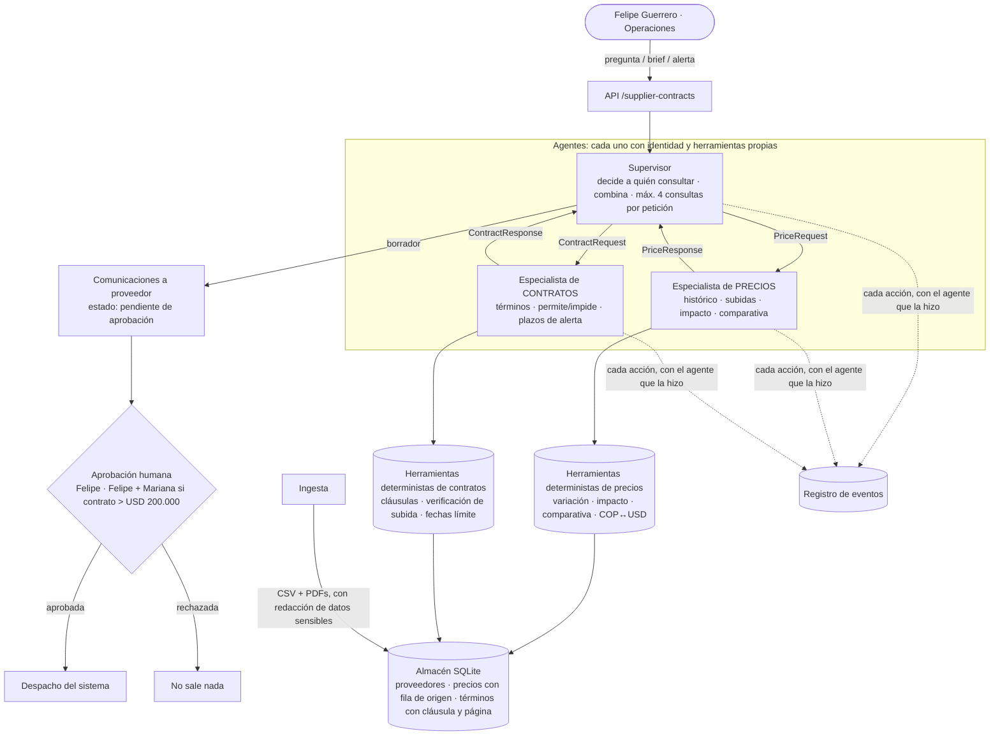

# Arquitectura · Gestión de proveedores y contratos (borrador previo al código)

## Qué hace cada pieza

| Pieza | Responsabilidad | Herramientas (solo las suyas) | NO puede |
|---|---|---|---|
| Supervisor | Recibe la petición, decide a quién consultar, combina en UNA respuesta, redacta borradores | `consult_price_specialist`, `consult_contract_specialist`, `compose_answer`, `draft_communication` | calcular, leer PDFs, enviar nada |
| Especialista de precios | Histórico por proveedor/producto, subidas sobre umbral, impacto, comparativa del mismo país y categoría | `read_prices`, `detect_increase`, `compute_impact`, `compare_peers`, `convert_currency` | leer contratos, enviar nada |
| Especialista de contratos | Qué permite o impide el contrato citando cláusula y página; fechas límite | `read_contract_terms`, `check_price_increase`, `compute_deadlines`, `convert_currency` | leer precios, enviar nada |

## Contratos de entrada y salida (detalle en la sección 3 del README)

Los modelos están en `data/pipelines/supplier_contracts/schemas.py` y son la única forma de hablar entre agentes: los especialistas no se
conocen entre sí (no hay bucles posibles) y el supervisor tiene además un tope de consultas por petición.

- `PriceRequest{action, supplier_id, as_of, compare_with?}` → `PriceResponse{status, increase, history[Fact], peers[PeerQuote], notes, missing}`
- `ContractRequest{action, supplier_id, as_of, increase_pct?}` → `ContractResponse{status, terms[Term], verdict, deadlines[Deadline], citations[Citation], missing}`
- `Fact`/`IncreaseInfo`/`PeerQuote` llevan `SourceRef{file, row}` · `Citation{contract_id, clause, page, quote, language, confidence, doubtful}`
- `SupervisorReply{intent, answer, consulted, consults_used, consults_limit, facts, citations, missing, truncated, brief}`

## Reglas transversales

1. **Nada de aritmética del modelo**: todo cálculo es código determinista con `Decimal` y pruebas.
2. **Trazabilidad**: cada cifra → fila del CSV; cada afirmación contractual → cláusula + página + cita en el idioma del contrato.
3. **Lo que no existe se declara** (`missing`): sin contrato, sin cláusula de preaviso, sin alternativa en el mismo país…
4. **El sistema prepara, las personas deciden**: las comunicaciones nacen `pending_approval`; ningún agente tiene permiso de envío.
5. **Datos sensibles** (cuentas bancarias y contacto personal de los contratos) se redactan en la ingesta: no llegan a BD, logs, mensajes ni API.
