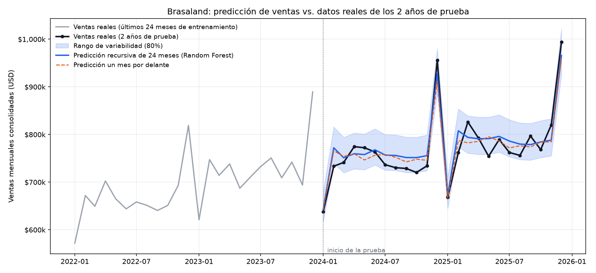

# Modelo de predicción de ventas de Brasaland

Regresión que predice las **ventas mensuales consolidadas** (`revenue_usd`) de las 14 ubicaciones. Responde a la
pregunta de Finanzas: *¿podemos anticipar cuánto venderemos en los próximos meses, con un error aceptable, antes de
construir un dashboard ejecutivo?* Sí, con un error medio de **2,7 %** sobre los 2 años que el modelo no vio.

## Cómo ejecutarlo

Desde la raíz del monorepo (dependencias con `uv`, nunca `pip`):

```bash
uv sync                                          # instala scikit-learn, xgboost, pandas, matplotlib, pytest
uv run python scripts/train_sales_forecast.py    # entrena, evalúa y guarda los resultados
uv run pytest tests/pipelines -v                 # pruebas del split y de la ausencia de fuga de datos
```

Salidas en `data/eval/sales_forecast/`: `metrics.json` (todas las métricas y la huella SHA-256 del dataset),
`predictions.csv` (mes a mes: real, previsto y rango) y `forecast.png` (la visualización).

## Datos

`data/raw/brasaland_sales.csv` es el dataset provisto por el curso y **no se modifica ni se regenera**:
120 meses (2016-01 a 2025-12), fila `consolidated`, columnas `month`, `revenue_usd`, `covers_served`,
`avg_ticket_usd` y `market`. El cargador valida las reglas del briefing (sin meses faltantes, ingresos positivos,
sin nulos, fechas en `YYYY-MM-01`) y acepta tanto comas como tabuladores.

Observaciones sobre el dataset, sin alterarlo:

- El crecimiento anual de la media sale entre el 2,6 % y el 9,0 % (el briefing habla de 3-7 %): es compatible con el
  ruido mensual de ±5 %, pero conviene saberlo.
- Enero cae entre un 11 % y un 16 % respecto a la media del año anterior (salvo 2023, −7 %), y diciembre sube un
  20-27 % sobre la media del año: el patrón de estacionalidad descrito está presente.
- La escala no coincide con `CONTEXT.es.md` (≈ 6 millones de dólares anuales): en el dataset eso es 2016; en 2025 son
  9,5 millones.
- `revenue_usd` es exactamente `covers_served × avg_ticket_usd` en todas las filas. Por eso esas dos columnas **no**
  se usan del propio mes: dejarían al modelo "adivinar" el resultado con datos que no se conocen de antemano.

## Split sin fuga de datos

Corte **temporal**, nunca aleatorio: los 8 primeros años (2016-01 → 2023-12, 96 meses) entrenan y los 2 más recientes
(2024-01 → 2025-12, 24 meses) comprueban. Para que la prueba sea honesta:

- Cada feature de un mes usa solo meses **anteriores**. La misma función construye las features al entrenar y al
  predecir, así que no puede haber desajuste entre ambos.
- El escalador (`StandardScaler`) se ajusta únicamente con las filas de entrenamiento.
- La elección del algoritmo se hace con validación walk-forward **dentro del entrenamiento**; la prueba no interviene.
- Los lags que cruzan la frontera (el primer mes de prueba usa los últimos meses de entrenamiento) son pasado, no fuga.

## Features

Las ventas crecen cada año, y un árbol no puede predecir valores mayores que los que vio al entrenar. Por eso el modelo
no predice dólares sino una **razón**: `ventas del mes / media de los 12 meses anteriores`, y después se vuelve a
dólares. Features (todas sin escala y causales): lags de 1, 2, 3 y 12 meses, medias móviles de 3 y 6 meses,
volatilidad de 6 meses, tendencia semestral y calendario (seno/coseno del mes, bandera de enero y de diciembre).
Con 12 meses de pasado necesarios, quedan 84 filas útiles de entrenamiento.

## Por qué Random Forest y no XGBoost

Se compararon con validación walk-forward en los últimos 3 años de entrenamiento (cada año se pronostica de forma
recursiva con un modelo entrenado solo con lo anterior):

| Algoritmo | RMSE medio | Error porcentual medio |
| --- | --- | --- |
| Random Forest | $27.902 | 3,52 % |
| XGBoost | $27.263 | 3,33 % |

XGBoost mejora el RMSE un 2,3 %. La regla se fijó **antes de mirar la prueba**: XGBoost solo se elige si mejora más
de un 5 %. Una diferencia así es menor que lo que varía un mismo modelo entre años (el error por año va de 2,8 % a
4,3 %), de modo que es un empate técnico. Se elige **Random Forest** porque con solo 84 filas útiles:

- **Explicabilidad:** promedia muchos árboles independientes y es lo más sencillo de contarle a Finanzas.
- **Menos riesgo de sobreajuste:** XGBoost corrige errores de forma secuencial y necesita más ajuste con tan pocos datos.
- **Menos hiperparámetros:** no hay tasa de aprendizaje que afinar, y los resultados son estables entre ejecuciones.

Comprobación posterior, **no usada para elegir**: sobre la prueba, XGBoost obtiene un error de 2,71 % frente a 2,72 %
de Random Forest. Confirma que la elección no sacrifica precisión.

La semilla está fijada (`random_state=42`) y el resultado es idéntico en cada ejecución.

## Resultados sobre el conjunto de prueba (2024-01 → 2025-12)

Cifra principal: **pronóstico recursivo de 24 meses**. Se parte de diciembre de 2023 y cada predicción alimenta la del
mes siguiente, como pasaría al pronosticar el futuro de verdad. Se muestra también el caso "un mes por delante"
(con las ventas reales de los meses anteriores).

| Métrica | Recursivo 24 meses (principal) | Un mes por delante |
| --- | --- | --- |
| **MSE** | 583.655.557 USD² | 593.534.266 USD² |
| RMSE (error típico en dólares) | $24.159 | $24.363 |
| Error porcentual medio | **2,72 %** | 2,63 % |
| **Gini** (normalizado) | 0,908 | 0,877 |
| **K2 Score** (R²) | 0,893 | 0,891 |
| **PSI** ventas en bruto (entrenamiento vs prueba) | 5,65, supera el ruido (p95 = 0,67): cambio real | |
| **PSI** razón ventas/nivel (sin tendencia) | 0,23, dentro del ruido (p95 = 0,60): sin cambio | |

Referencia: repetir "el mismo mes del año pasado" da un error de **4,78 %**; el modelo lo reduce un 43 %.

### Qué mide cada métrica y por qué un MSE bajo no basta

- **MSE** (error cuadrático medio, en USD²): la media de los errores al cuadrado. Es difícil de leer, así que se
  acompaña del **error porcentual medio** (2,72 %: "en promedio nos equivocamos un 2,7 %") y del RMSE (≈ $24 mil por
  mes sobre ventas de ≈ $770 mil). Por sí solo engaña: depende de la escala, los meses grandes (diciembre) pesan
  mucho y no dice si el modelo mejora una regla simple. Por eso se compara además con la referencia "el mismo mes del
  año pasado" (4,78 % de error) y se acompaña de R², Gini y PSI.
- **K2 Score** (se interpreta como **R²**): qué parte de la variación de las ventas explica el modelo. 1 es perfecto
  y 0 equivale a predecir siempre la media. Con 0,89 explica cerca del 90 %.
- **Gini** (normalizado): mide si el modelo **ordena bien los meses** de mejor a peor, sin importar el valor exacto.
  1 es el orden perfecto y 0 es no distinguir meses buenos de malos. Con 0,91 identifica los meses flojos con
  anticipación, que es lo que necesita Dirección.
- **PSI** (Population Stability Index): compara la distribución de la prueba con la de entrenamiento. Un PSI alto
  significa que el comportamiento cambió y el modelo habría que reentrenarlo. **Aquí hay que leerlo con cuidado:**
  - Las ventas en bruto sí cambian (PSI 5,65): la serie crece cada año y los 2 últimos años quedan por encima de casi
    todo lo visto en entrenamiento. Es la tendencia de crecimiento (≈ 5 % anual), **no un cambio estructural** como
    una apertura de ubicaciones. Se reentrena con datos nuevos al seguir creciendo.
  - Quitando el crecimiento (razón ventas/nivel), el PSI es 0,23 y no supera lo que produciría el azar. El patrón
    estacional y la dinámica mensual siguen siendo los mismos.
  - Con solo 24 meses de prueba, los umbrales genéricos (0,10 y 0,25) darían falsas alarmas. Por eso se usan
    quintiles y se compara con el PSI que saldría por azar (permutaciones, percentil 95).

## Rango de variabilidad

La gráfica no muestra un solo número optimista: junto a la predicción hay un **rango del 80 %** (de −4,2 % a +5,7 %
alrededor de cada predicción), calculado con los errores reales de la validación walk-forward. En la prueba, el 88 %
de los meses reales cae dentro del rango (algo conservador, que es preferible).



## Limitaciones

- Con 10 años de datos mensuales, la incertidumbre es considerable: el error por año de validación varía de 2,8 % a
  4,3 %. Hay que repetir la medición al disponer de nuevos meses.
- Los 24 meses del pronóstico recursivo acumulan error; para decisiones de compra conviene reentrenar cada mes y
  usar el horizonte corto.
- Solo se modela la fila `consolidated`. Colombia y Florida (≈ 25 % del total) no se modelan por separado.
- "K2 Score" no está definido en el ticket; se interpreta como R² (coeficiente de determinación).
